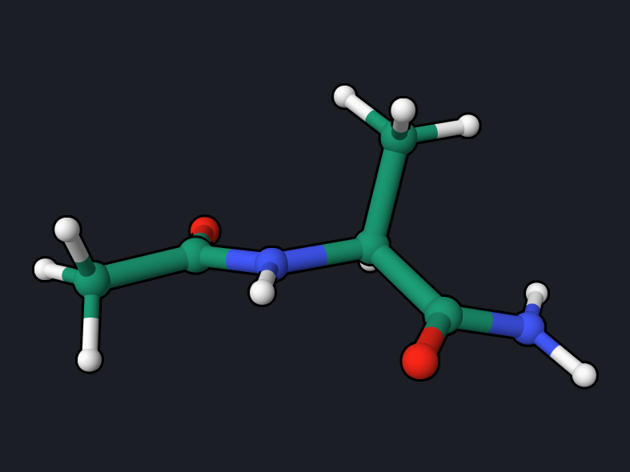
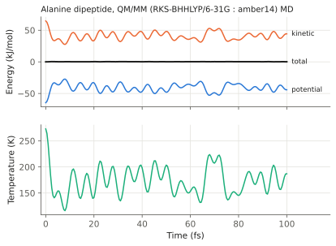

# Alanine Dipeptide: QM/MM Across a Covalent Bond

In the [formaldehyde QM/MM examples](formaldehyde-qmmm.md) the QM region is a
whole molecule. In proteins the QM region usually cuts through covalent bonds.
OpenQP then caps each cut bond with a hydrogen link atom. This example puts the
C-terminal amide group of the alanine dipeptide in the QM region, optimizes it
inside the fixed MM environment, and runs ground-state QM/MM dynamics.

<div class="oqp-figs" markdown>
<figure markdown>

<figcaption>Alanine dipeptide after the QM/MM optimization; the QM region is
the –C(=O)NH₂ group on the right</figcaption>
</figure>
</div>

## Files

Download into one folder:
[ala-qmmm-opt.oqp](inputs/ala-qmmm-opt.oqp),
[ala-qmmm-md.oqp](inputs/ala-qmmm-md.oqp), and
[ala.pdb](inputs/ala.pdb) (the alanine dipeptide, 19 atoms, from the
repository QM/MM examples). The amber14 force field ships with OpenMM, which
must be installed (`pip install openmm`).

## Step 1: QM/MM optimization

```text title="ala-qmmm-opt.oqp"
rhf/6-31g opt(S0) qmmm(forcefield_files="amber14-all.xml",qm_atoms="8,9,16,17,18",cutoff=NoCutoff)
geom="ala.pdb"
```

```bash
openqp ala-qmmm-opt.oqp
```

- `qm_atoms="8,9,16,17,18"` (0-based PDB order) selects the carbonyl C and O
  and the N, H1, and H2 of the terminal NH₂. Everything else is MM, described
  by amber14 with `cutoff=NoCutoff` (an isolated, non-periodic system).
- The selection cuts the bond between the carbonyl C and Cα. OpenQP adds one
  hydrogen link atom on that bond, so the QM calculation is effectively on
  formamide, H–C(=O)–NH₂, polarized by the MM charges.
- In a QM/MM optimization only the QM atoms move; the 14 MM atoms stay fixed.

The run takes about 1 minute:

```text
   PyOQP: QM/MM geometry optimisation: 5 QM atoms, 5 movable atoms (radius 0.0 A, 0 constrained distances), 14 fixed; state 0; native RFO/BFGS, cartesian coordinates, trust 0.20 (max 0.50) bohr, maxit 30
   PyOQP: QM/MM optimisation converged after 59 evaluations: E = -168.9275191488 Hartree, rms grad 9.24e-05, max grad 1.81e-04 Hartree/bohr; full-system geometry written to ala-qmmm-opt_opt.pdb
```

The optimized full system is written as a PDB file,
`ala-qmmm-opt_opt.pdb`, which is the structure in the picture above.

## Step 2: QM/MM molecular dynamics

```text title="ala-qmmm-md.oqp"
rks/bhhlyp/6-31g md(nstep=200,dt=0.5,temperature=300,seed=2) qmmm(forcefield_files="amber14-all.xml",qm_atoms="8,9,16,17,18",cutoff=NoCutoff)
geom="ala.pdb"
```

```bash
openqp ala-qmmm-md.oqp
```

Now all 19 atoms move: the QM region on the BHHLYP surface and the rest on the
amber14 surface, coupled through the embedding. 200 steps of 0.5 fs take about
6 minutes with 4 threads. This QM/MM dynamics driver writes fixed file names:

| File | Contents |
| --- | --- |
| `oqp_project.log` | the log |
| `qmmm_trajectory.pdb` | all 201 frames of the full system, for VMD or OQP Studio |
| `total_energy.npz` | step, time (ps), potential, kinetic, and total energy (kJ/mol), temperature |



| Quantity | Reference trajectory |
| --- | --- |
| Initial temperature | 273 K (one 300 K draw for 19 atoms) |
| Mean temperature | 173 K |
| Total-energy range over 100 fs | 0.37 kJ/mol |

## Reading the result

- **Energy is conserved across the boundary.** The total energy varies by
  0.37 kJ/mol over 100 fs while about 50 kJ/mol moves back and forth between
  kinetic and potential energy, so the forces of the QM region, the link atom,
  and the MM part are consistent.
- **The QM energy depends on the boundary.** −168.93 hartree is the energy of
  the capped QM fragment in the field of the MM atoms, not of the whole
  molecule; compare such energies only between calculations with the same QM
  region.
- Place the cut on a nonpolar single bond, away from the chemistry of
  interest; here it is the C–Cα single bond next to the amide group, so a larger
  QM region is the natural check.

## Try next

- Enlarge the QM region to the whole C-terminal residue and compare the
  optimized amide geometry.
- See the repository
  [`examples/QMMM`](https://github.com/Open-Quantum-Platform/openqp/tree/main/examples/QMMM)
  for other boundary treatments (`frontier_scheme`), constraints, and
  excited-state dynamics.

See also: [`qmmm`](../keywords/qmmm.md),
[covalent QM/MM boundaries](../keywords/qmmm.md#covalent-qmmm-boundaries).
