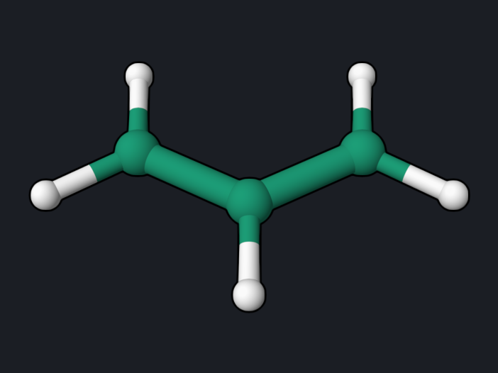

# Allyl Radical: Open-Shell DFT and Spin Density

The allyl radical, CH₂=CH–CH₂•, has one unpaired electron shared between the
two terminal carbons. An unrestricted Kohn–Sham (UKS) calculation describes
it with separate α and β orbitals, and the difference of their densities, the
spin density, shows where the unpaired electron lives. This example optimizes
the radical and draws its spin density.

<div class="oqp-figs" markdown>
<figure markdown>

<figcaption>Allyl radical, C2v</figcaption>
</figure>
<figure markdown>

<figcaption>Spin density (±0.005 a.u.): excess α spin on the terminal carbons
(blue), excess β spin on the central carbon (red)</figcaption>
</figure>
</div>

## Copy and run

```text title="allyl-radical.oqp"
uks/pbe0/6-31g* mult=2 opt
geom="""
C      0.000000     0.000000     0.479931
C      0.000000     1.227297    -0.172634
C      0.000000    -1.227297    -0.172634
H      0.000000     0.000000     1.569931
H      0.000000     1.264989    -1.251976
H      0.000000     2.143189     0.399679
H      0.000000    -2.143189     0.399679
H      0.000000    -1.264989    -1.251976
"""
```

[Download allyl-radical.oqp](inputs/allyl-radical.oqp)

```bash
openqp allyl-radical.oqp
```

`uks/pbe0/6-31g*` selects an unrestricted Kohn–Sham reference, and `mult=2`
sets the doublet spin multiplicity. The starting structure is planar; the
optimization keeps the C2v symmetry and converges in 6 steps, in about 10
seconds with 8 threads.

## What you get

| Quantity | Reference value |
| --- | --- |
| Final energy | −117.1066345 hartree |
| Point group | C2v |
| r(C–C) | 1.384 Å (both bonds equal) |
| ∠C–C–C | 124.8° |
| Mulliken spin population, terminal C | +0.735 each |
| Mulliken spin population, central C | −0.329 |
| ⟨S²⟩ of the Kohn–Sham determinant | 0.793 (exact doublet: 0.75) |

The two C–C bonds are equal: the radical is delocalized, not a localized C=C
double bond next to a CH₂ radical. The spin populations and ⟨S²⟩ were
computed from the α and β orbitals in
`allyl-radical_scf_uhf_pbe0_6-31gs.molden`; the same file is used to draw the
spin density.

## Reading the result

- The unpaired electron occupies the nonbonding π orbital of allyl, which has
  its density on the terminal carbons and a node at the central carbon. That is
  why the terminal carbons carry most of the α spin.
- The negative spin on the central carbon is spin polarization: the unpaired
  α electron slightly separates the α and β electrons of the doubly occupied π
  orbital. A restricted open-shell (ROKS) calculation cannot show this effect,
  because it forces the paired electrons into the same spatial orbital.
- The integrated spin density is 1.000, one unpaired electron.

## Try next

- Replace `uks` with `roks`, without `opt`, for a restricted open-shell
  single point at the starting structure. The ROKS energy is −117.1007357
  hartree, 5.4 millihartree (3.4 kcal/mol) above UKS at the same structure
  (−117.1061294 hartree, step 1 of the optimization), because the spin
  polarization is missing.

See also: [HF and DFT](../workflows/hf-dft.md),
[`.oqp` routes](../oqp-input.md).
