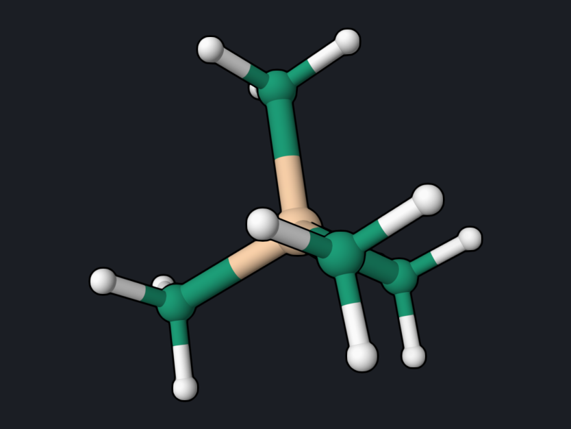

# Benzene: NMR Chemical Shifts

An NMR calculation gives the absolute magnetic shielding σ of every nucleus.
Spectra report chemical shifts δ relative to a reference compound, so two
calculations at the same level are needed: the molecule of interest and the
reference, tetramethylsilane (TMS). Then

δ = σ(TMS) − σ(molecule).

<div class="oqp-figs" markdown>
<figure markdown>

<figcaption>Benzene (D6h)</figcaption>
</figure>
<figure markdown>

<figcaption>Tetramethylsilane, the shift reference</figcaption>
</figure>
</div>

## Copy and run

```text title="benzene-nmr.oqp"
dft/pbe0/6-31g* nmr
geom="""
C      1.392883     0.000000     0.000000
C      0.696465     1.206259     0.000000
C     -0.696465     1.206259     0.000000
C     -1.392883     0.000000     0.000000
C     -0.696465    -1.206259     0.000000
C      0.696465    -1.206259     0.000000
H      2.479666     0.000000     0.000000
H      1.239913     2.147463     0.000000
H     -1.239913     2.147463     0.000000
H     -2.479666     0.000000     0.000000
H     -1.239913    -2.147463     0.000000
H      1.239913    -2.147463     0.000000
"""
```

[Download benzene-nmr.oqp](inputs/benzene-nmr.oqp) ·
[Download tms-nmr.oqp](inputs/tms-nmr.oqp) (TMS, 17 atoms, same first line)

```bash
openqp benzene-nmr.oqp
openqp tms-nmr.oqp
```

`nmr` computes GIAO (gauge-including atomic orbital) shieldings, which do not
depend on the choice of coordinate origin. Both geometries were optimized at
PBE0/6-31G*. Benzene takes about 25 seconds and TMS about 40 seconds.

## What you get

The end of each log has the isotropic shielding of every atom, in ppm. The
column to use is `total_coupled`, which includes the response of the orbitals to
the magnetic field (coupled-perturbed Kohn–Sham). For benzene:

```text
    Isotropic shielding (GIAO, ppm)   [exact-exchange c_x =  0.2500]
       Atom    Z   sigma_dia   para_uncoupled   para_coupled   total_uncoupled   total_coupled
         1   6.0      256.824629     -143.610570     -184.723650      113.214059       72.100980
         2   6.0      256.835108     -143.625026     -184.741975      113.210082       72.093133
       ...
         7   1.0       29.549782       -3.924546       -4.810611       25.625236       24.739171
         8   1.0       29.545189       -3.921758       -4.807423       25.623431       24.737766
```

Equivalent atoms agree to 0.01 ppm; the small spread comes from the DFT
integration grid. Averaging over equivalent atoms:

| Nucleus | σ(benzene) | σ(TMS) | δ = σ(TMS) − σ | Experiment (CDCl₃) |
| --- | --- | --- | --- | --- |
| ¹H | 24.738 ppm | 32.109 ppm | **7.37 ppm** | 7.34 ppm |
| ¹³C | 72.10 ppm | 194.49 ppm | **122.4 ppm** | 128.4 ppm |

TMS has four equivalent carbons and twelve equivalent hydrogens; its geometry
here is not exactly Td, and the individual values spread by 0.2 ppm (C) and
0.02 ppm (H) around the averages above.

## Reading the result

The ¹H shift is close to experiment. The ¹³C shift is 6 ppm too low; ¹³C
shieldings depend more strongly on the functional and the basis set than ¹H
shieldings, so test a larger basis set such as `cc-pvtz` before relying on
absolute ¹³C values. The experimental values are for solution, while the
calculation is for an isolated molecule.

## Cross-check

To test the GIAO implementation, the benzene calculation was repeated at the
Hartree–Fock level (`hf/6-31g* nmr`) in OpenQP and in PySCF 2.13 at the same
geometry. Both give σ(C) = 73.519 ppm and σ(H) = 25.083 ppm.

## Try next

- Compute the shifts of a substituted benzene, such as toluene, at the same
  level; the TMS reference values above can be reused.
- Repeat the benzene run at the Hartree–Fock level, `hf/6-31g* nmr`, and
  compare with the values in the cross-check above.

See also: [NMR, IR, and Raman](../workflows/nmr-ir-raman.md),
[`properties`](../keywords/properties.md).
