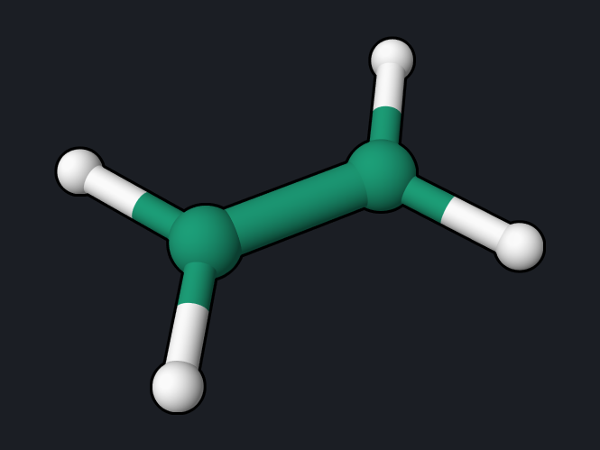

# Ethylene with CASSCF and XMCQDPT2

The [twist example](ethylene-twist.md) treats twisted ethylene with
MRSF-TDDFT. This page uses wavefunction methods for the same problem: CASSCF
geometry optimizations of planar and twisted ethylene with two electrons in the
π and π\* orbitals, and multistate perturbation theory (XMCQDPT2) for the
ground and excited states.

<div class="oqp-figs" markdown>
<figure markdown>

<figcaption>Planar minimum</figcaption>
</figure>
<figure markdown>

<figcaption>Twisted (90°) structure</figcaption>
</figure>
</div>

## Step 1: CASSCF(2,2) geometry optimization

```text title="ethylene-twisted-casscf-opt.oqp"
casscf/6-31g* opt cas(active_electrons=2,active_orbitals=2)
geom="""
C      0.000000     0.000000     0.664311
C      0.000000     0.000000    -0.664311
H      0.000000     0.923944     1.237411
H      0.000000    -0.923944     1.237411
H      0.923944     0.000000    -1.237411
H     -0.923944     0.000000    -1.237411
"""
```

[Download ethylene-twisted-casscf-opt.oqp](inputs/ethylene-twisted-casscf-opt.oqp) ·
[ethylene-planar-casscf-opt.oqp](inputs/ethylene-planar-casscf-opt.oqp) (same
first line, planar start)

CASSCF optimizes the orbitals and the configuration-interaction coefficients
together, and OpenQP computes its nuclear gradient analytically, so `opt` works
directly. The twisted start keeps its D2d symmetry, so the optimization finds
the best twisted structure, which is the transition state for rotation about
the C=C bond. The two runs take 7 and 11 seconds.

| Structure | E(CASSCF) (hartree) | r(C–C) | r(C–H) | ∠HCH |
| --- | --- | --- | --- | --- |
| Planar minimum | −78.0602554 | 1.338 Å | 1.076 Å | 116.5° |
| Twisted (90°), optimized | −77.9580116 | 1.465 Å | 1.076 Å | 117.2° |

The relaxed rotation barrier is 0.1022 hartree, **2.78 eV** (64 kcal/mol),
close to the experimental activation energy for cis–trans isomerization of
ethylene derivatives of about 65 kcal/mol. With bond lengths frozen at the
planar values the barrier is 3.20 eV (the dashed curve on the
[twist page](ethylene-twist.md)): stretching the C–C bond to 1.465 Å, close to a
single bond, lowers the twisted structure by 0.4 eV.

## Step 2: XMCQDPT2 for the ground and excited states

```text title="ethylene-planar-xmcqdpt2.oqp"
xmcqdpt2/6-31g* cas(active_electrons=2,active_orbitals=2,frozen_core=7) ci(nroot=3,target_spin=singlet) pt2(target_roots="0,1,2",nroot=3,edshft=0.02)
geom="""
C      0.000000     0.000000     0.664311
C      0.000000     0.000000    -0.664311
H      0.000000     0.923944     1.237411
H      0.000000    -0.923944     1.237411
H      0.000000     0.923944    -1.237411
H      0.000000    -0.923944    -1.237411
"""
```

[Download ethylene-planar-xmcqdpt2.oqp](inputs/ethylene-planar-xmcqdpt2.oqp) ·
[ethylene-twisted-xmcqdpt2.oqp](inputs/ethylene-twisted-xmcqdpt2.oqp) (the 90°
geometry)

- `xmcqdpt2` is extended multiconfiguration quasi-degenerate second-order
  perturbation theory: three CAS(2,2) states are corrected together and allowed
  to mix, which keeps the states smooth near degeneracies.
- `frozen_core=7` counts the seven doubly occupied orbitals outside the active
  space (see the [LiH page](lih-caspt2.md) for this convention), and
  `edshft=0.02` is a small denominator shift that avoids intruder states.

Each run takes about 4 seconds. The geometries are those of the MRSF twist
scan, so the results can be compared directly:

| Quantity | XMCQDPT2 | MRSF-TDDFT | CASSCF(2,2) |
| --- | --- | --- | --- |
| S0 rise at 90° (rigid twist) | 3.17 eV | 3.54 eV | 3.20 eV |
| S0 → S1 at the planar geometry | 8.80 eV | 8.38 eV | — |
| S1 − S0 at 90° | 2.68 eV | 2.23 eV | — |

```text
   PyOQP state 0                            -78.2943723081
   PyOQP state 1                            -77.9710533525
   PyOQP state 2                            -77.7803082396
```

## Reading the result

- **CASSCF(2,2) gets the shape right** at very low cost: it is the minimal
  wavefunction that describes the broken π bond at 90°. Its rotation barrier
  is close to experiment.
- **The excitation energies need dynamic correlation.** The planar S1 (the
  ππ\* V state) is notoriously sensitive to σ–π correlation; with a CAS(2,2)
  reference and the 6-31G\* basis set XMCQDPT2 puts it at 8.80 eV, and
  MRSF-TDDFT at 8.38 eV, both above the experimental band maximum of about
  7.7 eV. A larger active space and diffuse basis functions are needed for a
  quantitative V state.
- For the ground-state twist barrier, the three methods agree within 0.4 eV.

## Try next

- Use `xms-caspt2` instead of `xmcqdpt2` for a small molecule (see the
  [LiH page](lih-caspt2.md) for the size limit of the uncontracted CASPT2).
- Optimize the excited state with `casscf/6-31g* opt(S1)` and state averaging,
  as in the repository
  [`examples/WF_methods`](https://github.com/Open-Quantum-Platform/openqp/tree/main/examples/WF_methods).

See also: [CASSCF Nuclear Gradient](../workflows/casscf-gradient.md),
[Wavefunction methods](../keywords/wavefunction.md).
