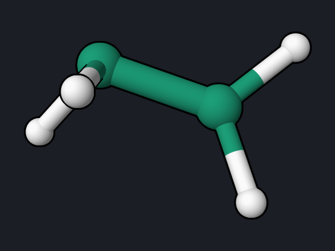
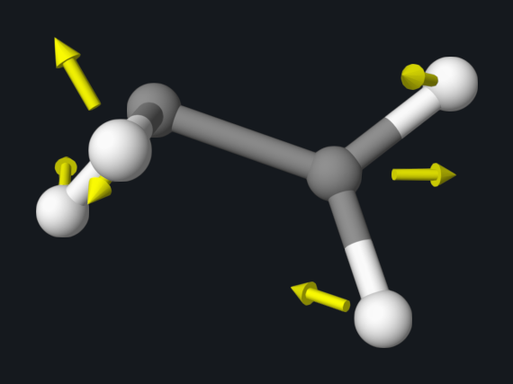
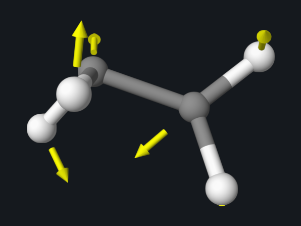
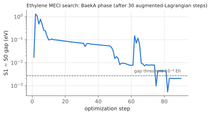
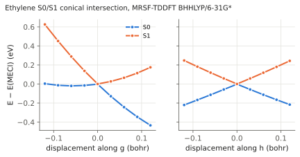

# Ethylene: Conical Intersection (MECI)

After light absorption, ethylene returns to its ground state in less than a
picosecond through a conical intersection: a geometry where S1 and S0 have the
same energy. This example locates the minimum-energy conical intersection
(MECI), computes the two vectors that define the cone, and maps the two
surfaces around it.

<div class="oqp-figs" markdown>
<figure markdown>

<figcaption>MECI: twisted by 70° with one pyramidal CH₂ group</figcaption>
</figure>
<figure markdown>

<figcaption>g: gradient difference of S1 and S0</figcaption>
</figure>
<figure markdown>

<figcaption>h: nonadiabatic coupling of S0 and S1</figcaption>
</figure>
</div>


## Step 1: locate the MECI

```text title="ethylene-meci.oqp"
mrsf(nstate=5)/bhhlyp/6-31g* meci(S0,S1)
geom="""
C      0.183466     0.241588    -0.744012
C      0.045460     0.049255     0.641761
H     -0.807555     0.345092    -1.227068
H      0.563551    -0.668990    -1.245075
H      0.543761     0.743574     1.341573
H     -0.528683    -0.710519     1.232820
"""
```

[Download ethylene-meci.oqp](inputs/ethylene-meci.oqp)

```bash
openqp ethylene-meci.oqp
```

`meci(S0,S1)` minimizes the energy on the S0/S1 crossing seam. MRSF-TDDFT is
needed here because S0 must be described correctly where it meets S1; see the
[twisted ethylene example](ethylene-twist.md). Five states are computed so
that the two lowest are followed reliably. The starting structure is already
twisted and pyramidalized.

The run takes about 3.5 minutes. OpenQP first runs 30 steps of an
augmented-Lagrangian search, then continues with the BaekA algorithm until the
gap and the projected gradient meet their thresholds:

```text
   PyOQP: BaekA Geometry Optimization Has Converged
```



| Quantity | Reference value |
| --- | --- |
| Mean S0/S1 energy at the MECI | −78.3429258 hartree |
| S1 − S0 gap | 7.6 × 10⁻⁵ hartree (2 meV) |
| Energy above the planar S0 minimum | 4.98 eV (vertical S1 at the minimum: 8.38 eV) |
| r(C–C) | 1.381 Å |
| Twist between the CH₂ planes | 70° |
| Sum of the three angles at C1 / C2 | 295° (pyramidal) / 360° (planar) |

The MECI lies 3.4 eV below the vertically excited S1 state, so an excited
molecule can reach it easily. The geometry—twisted with one pyramidalized
carbon—is the well-known twisted-pyramidalized intersection of ethylene.

## Step 2: the branching vectors g and h

Away from the MECI the degeneracy is lifted along two directions: the gradient
difference g = ∇E(S1) − ∇E(S0) and the nonadiabatic coupling vector h. Compute
them at the MECI geometry from `opt.xyz`:

```text title="ethylene-meci-grad-s0.oqp"
mrsf(nstate=5)/bhhlyp/6-31g* grad(S0)
geom="""
C      0.357265     0.223227    -0.756478
C      0.096381     0.077437     0.592011
H     -0.777577     0.294630    -0.911117
H      0.439342    -0.722961    -1.305394
H      0.454605     0.792671     1.330762
H     -0.570016    -0.665004     1.050215
"""
```

[Download ethylene-meci-grad-s0.oqp](inputs/ethylene-meci-grad-s0.oqp) ·
[ethylene-meci-grad-s1.oqp](inputs/ethylene-meci-grad-s1.oqp) (same with
`grad(S1)`) ·
[ethylene-meci-nac.oqp](inputs/ethylene-meci-nac.oqp)

The nonadiabatic coupling uses the same geometry with this first line:

```text
mrsf(nstate=5)/bhhlyp/6-31g* nac(S0,S1,type=analytical) scf(conv=1e-10) tdhf(conv=1e-10)
```

Analytic NAC needs SCF and response equations converged to at least 10⁻⁸;
OpenQP stops with an input error that says so if the thresholds are looser. Each
gradient takes a few seconds and the NAC about 10 seconds. The NAC log prints
both forms of the coupling:

```text
   PyOQP NAC vector between S0 and S1 in Hartree/Bohr gap:       0.00007654
   C        0.01567208       0.00405847      -0.00137273
   C       -0.00843894      -0.01782201      -0.01655380
   ...
   PyOQP DC vector between S0 and S1 in 1/Bohr gap:       0.00007654
   C      204.76931355      53.02741691     -17.93597594
   ...
```

The NAC vector h = (E1 − E0) d stays finite, while the derivative coupling d
becomes very large because the gap is nearly zero. From the gradient runs and
the NAC vector:

| Quantity | Reference value |
| --- | --- |
| \|g\| | 0.188 hartree/bohr |
| \|h\| | 0.072 hartree/bohr |
| cos(g, h) | −0.16 (nearly perpendicular) |

The arrow pictures above show the direction of each vector on every atom.

## Step 3: map the cone

Displacing the MECI geometry along g and h (orthonormalized, ±0.12 bohr in
steps of 0.03 bohr) and running a single-point MRSF energy at each of the 81
points gives the double cone in the figure at the top: S1 and S0 touch at the
MECI and separate linearly in every direction of the plane. Along the two
axes:



At the centre the gap is 2 meV; at the edge of the grid it reaches 0.8 eV.
Along h the two surfaces open symmetrically (S0 −0.22 eV, S1 +0.24 eV at
±0.12 bohr). Along g the cone is tilted: at +0.12 bohr S0 has dropped by
0.43 eV while S1 has risen only 0.18 eV, and at −0.12 bohr S1 rises by 0.63 eV
while S0 stays flat. S1 rises in every direction away from the MECI, so the
intersection is peaked: a molecule moving on S1 is funnelled toward the tip,
and after passing through it the steepest descent on S0 is along +g.

## Try next

- Run surface-hopping dynamics from S1 and watch a trajectory reach this
  region: see the [ethylene NAMD example](ethylene-namd.md).
- Add S2 to the search, `meci(S0,S1,S2)`, to look for a three-state
  intersection (see [BaekA Multistate MECI](../workflows/baeka-multistate-meci.md)).

See also: [BaekA Multistate MECI](../workflows/baeka-multistate-meci.md),
[NACME](../workflows/nacme.md), [MRSF-TDDFT](../workflows/mrsf-tddft.md).
