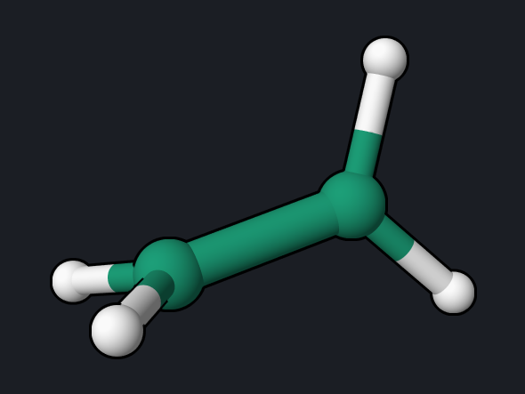
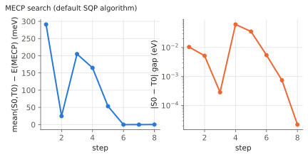

# Ethylene: Singlet–Triplet Crossing (MECP)

A minimum-energy crossing point (MECP) is the lowest-energy geometry at which
two states of different spin multiplicity have the same energy. It is where
intersystem crossing between a singlet and a triplet is most likely, and the
spin-orbit coupling there sets how fast the crossing happens. This example
finds the S0/T0 MECP of ethylene with MRSF-TDDFT and computes the spin-orbit
coupling at that point.

<div class="oqp-figs" markdown>
<figure markdown>

<figcaption>S0/T0 MECP: twisted by 88°, C–C stretched to 1.442 Å</figcaption>
</figure>
</div>


## Step 1: locate the MECP

```text title="ethylene-mecp.oqp"
mrsf(nstate=5)/bhhlyp/6-31g* mecp(S0,T0)
geom="""
C      0.000000     0.000000     0.664311
C      0.000000     0.000000    -0.664311
H      0.000000     0.923944     1.237411
H      0.000000    -0.923944     1.237411
H      0.923944     0.000000    -1.237411
H     -0.923944     0.000000    -1.237411
"""
```

[Download ethylene-mecp.oqp](inputs/ethylene-mecp.oqp)

```bash
openqp ethylene-mecp.oqp
```

`mecp(S0,T0)` searches for the lowest point where the singlet S0 and the
triplet T0 cross. MRSF-TDDFT gives both states from the same calculation. The
start is the rigidly twisted ethylene of the [twist example](ethylene-twist.md),
where T0 lies 0.01 eV below S0. The default algorithm is SQP (sequential
quadratic programming), which solves for the step and the gap constraint
together:

```text
   PyOQP mecp search algorithm:                   sqp
   PyOQP: Geometry Optimization Has Converged
```

The search converges in 9 steps, in about 17 seconds.



The plot uses the S0 and T0 energies printed for each step in the log. (In
OpenQP 1.3.1 the step table in `opt_status.txt` shows −78.52136 hartree at step
4, which does not correspond to any computed state energy; the computed S0 and
T0 at that step are −78.40170 and −78.39942 hartree.)

The final `ENERGIES AND STATES` block lists the five singlets followed by the
five triplets. In OpenQP 1.3.1 the triplets are printed with the labels S5–S9;
`S5` is T0:

```text
   PyOQP S0                                 -78.4066167269
   PyOQP S1                                 -78.3101111447
   ...
   PyOQP S5                                 -78.4066167255
```

| Quantity | Reference value |
| --- | --- |
| E(S0) = E(T0) at the MECP | −78.4066167 hartree |
| Energy above the planar S0 minimum | 3.24 eV |
| r(C–C) | 1.442 Å (1.328 Å at the planar minimum) |
| Twist between the CH₂ planes | 88.4° |
| CH₂ groups | planar (sum of angles at each C: 360.0°) |

## Step 2: spin-orbit coupling at the MECP

```text title="ethylene-mecp-soc.oqp"
mrsf(nstate=3)/bhhlyp/6-31g* soc
geom="""
C      0.000000     0.000000     0.720836
C      0.000000     0.000000    -0.720836
H      0.012804     0.917650     1.291709
H     -0.012804    -0.917650     1.291709
H      0.917650     0.012804    -1.291709
H     -0.917650    -0.012804    -1.291709
"""
```

[Download ethylene-mecp-soc.oqp](inputs/ethylene-mecp-soc.oqp)

The run takes about 3 seconds. The S0–T0 coupling:

```text
     S0    / T0(Ms=-1)       0.0000      0.0000     -0.0000     -0.0000    0.000000000000
     S0    / T0(Ms= 0)       0.0000      0.4611      0.0000     -0.2325    0.228619235459
     S0    / T0(Ms=+1)       0.0000     -0.0000     -0.0000      0.0000    0.000000000000
```

and the spin-orbit states at the crossing:

```text
  State    cm-1        eV        Composition

     1       -0.23   -0.000028    T0( 0) ( 50.7%)         S0 ( 49.3%)
     2       -0.00   -0.000000    T0(+1) ( 50.0%)     T0(-1) ( 50.0%)
     3       -0.00   -0.000000    T0(-1) ( 50.0%)     T0(+1) ( 50.0%)
     4        0.23    0.000029        S0 ( 50.7%)     T0( 0) ( 49.3%)
```

## Reading the result

- **Relaxation lowers the crossing.** With rigid bond lengths, S0 and T0 meet
  near 90° at about 3.53 eV. Letting the C–C bond stretch to a single-bond
  length of 1.442 Å brings the crossing down to 3.24 eV.
- **The spin-orbit coupling is tiny.** Only the Ms = 0 component couples, by
  0.23 cm⁻¹. Because S0 and T0 are degenerate at the MECP, even this small
  coupling mixes them 50:50, but the splitting it produces is only 0.46 cm⁻¹.
  For comparison, in formaldehyde, where n and π orbitals change between the
  coupled states, the couplings are about 50 cm⁻¹ (see the
  [SOC example](formaldehyde-soc.md)). In a light hydrocarbon with only
  π-type states, singlet–triplet crossing is slow.

## Try next

- Search for the S1/T1 crossing of formaldehyde with `mecp(S1,T1)` from the
  geometry of the [SOC example](formaldehyde-soc.md), and compute the SOC there.
- Start the ethylene search from a pyramidalized structure and check whether
  it finds the same MECP.

See also: [Optimization](../workflows/optimization.md) (MECP algorithms),
[Spin-Orbit Coupling](../workflows/soc.md),
[conical intersection example](ethylene-meci.md).
