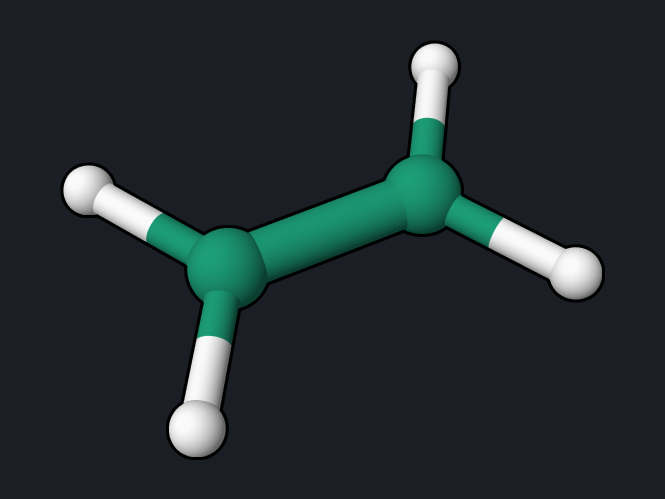
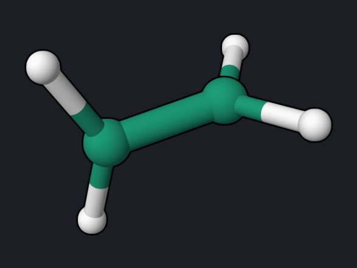
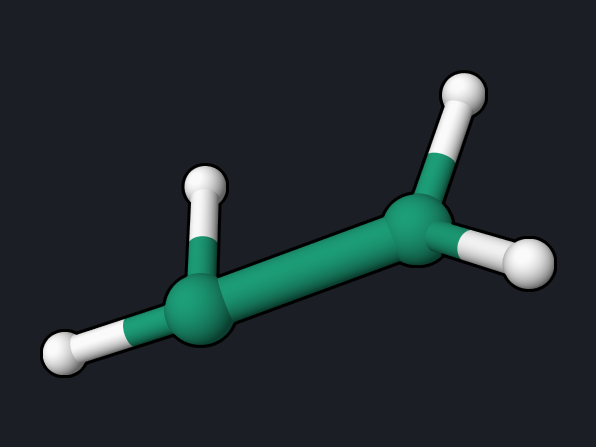
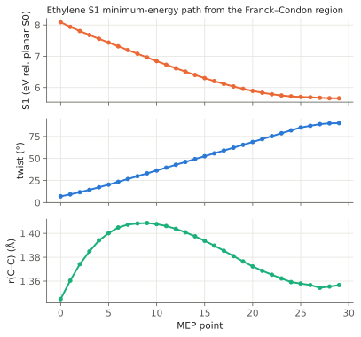

# Ethylene: Nonadiabatic Dynamics from S1

Surface-hopping molecular dynamics follows the nuclei classically on one
electronic state at a time and lets them hop between states. This example
starts one trajectory of ethylene on S1 and follows it for 150 fs: the C=C bond
twists, the molecule reaches the region of the
[conical intersection](ethylene-meci.md), and it returns to S0.

<div class="oqp-figs" markdown>
<figure markdown>

<figcaption>t = 0 fs, planar, on S1</figcaption>
</figure>
<figure markdown>

<figcaption>t = 25 fs, twisted</figcaption>
</figure>
<figure markdown>

<figcaption>t = 101.5 fs, hop to S0</figcaption>
</figure>
<figure markdown>

<figcaption>t = 123 fs, vibrationally hot S0</figcaption>
</figure>
</div>

## Copy and run

```text title="ethylene-namd.oqp"
mrsf(nstate=3)/bhhlyp/6-31g namd(S1,scheme=BaeckAn) md(nstep=300,dt=0.5,temperature=300,seed=7)
geom="""
C      0.000000     0.000000     0.664311
C      0.000000     0.000000    -0.664311
H      0.000000     0.923944     1.237411
H      0.000000    -0.923944     1.237411
H      0.000000     0.923944    -1.237411
H      0.000000    -0.923944    -1.237411
"""
```

[Download ethylene-namd.oqp](inputs/ethylene-namd.oqp)

```bash
openqp ethylene-namd.oqp
```

- `mrsf(nstate=3)/bhhlyp/6-31g`: three MRSF-TDDFT singlet states. The smaller
  6-31G basis set keeps each step to about 2 seconds.
- `namd(S1,scheme=BaeckAn)`: start on S1 and use Tully surface hopping with
  Baeck–An time-derivative couplings, which are computed from the state
  energies alone.
- `md(nstep=300,dt=0.5,temperature=300,seed=7)`: 300 steps of 0.5 fs, initial
  velocities drawn from a 300 K Maxwell–Boltzmann distribution with a fixed
  random seed, so the run is reproducible.

The run takes about 9 minutes with 4 threads.

## What you get

Each step prints one line to the log; `active` is the current state (1 = S0,
2 = S1, 3 = S2) and `pop` the electronic populations:

```text
   NAMD step    202  t=  101.000 fs  active=2  E_tot=-78.19130471  E_pot=-78.26615272 ...
   NAMD step    203  t=  101.500 fs  active=1  E_tot=-78.19055127  E_pot=-78.28035803 ...
```

The full trajectory, with all state energies, populations, couplings,
coordinates, and velocities at every step, is in the binary file
`ethylene-namd.namd.trj`. Read it from Python:

```python
from oqp.library.namd import read_namd_trajectory

header, rec = read_namd_trajectory("ethylene-namd.namd.trj")
t = rec["time_fs"]                 # (nstep,)
energies = rec["state_energies"]   # (nstep, nstate) in hartree
active = rec["active"]             # 1-based active state
xyz = rec["coordinates_bohr"]      # (nstep, natom, 3)
```


| Event | Reference trajectory |
| --- | --- |
| Initial kinetic temperature | 395 K (one random sample of the 300 K distribution) |
| C=C twist reaches about 90° | by 25 fs |
| Hops between S1 and S2 | 10, between 1.5 and 88 fs |
| Hop to S0 | 101.5 fs, where the S1–S0 gap is 0.23 eV |
| Total-energy range over 150 fs | 2.0 × 10⁻³ hartree (0.05 eV) |

## The static picture: S1 minimum-energy path

The trajectory follows the steepest way down on S1 only roughly, because the
nuclei carry kinetic energy. The minimum-energy path (MEP) on S1 from the
Franck–Condon region shows the underlying landscape:

```text title="ethylene-s1-mep.oqp"
mrsf(nstate=5)/bhhlyp/6-31g* mep(S1,maxit=100)
geom="""
C      0.000000     0.000000     0.664311
C      0.000000     0.000000    -0.664311
H      0.000000     0.923944     1.237411
H      0.000000    -0.923944     1.237411
H     -0.080527     0.920428    -1.237411
H      0.080527    -0.920428    -1.237411
"""
```

[Download ethylene-s1-mep.oqp](inputs/ethylene-s1-mep.oqp)

The start is the planar geometry with one CH₂ group turned by 5°: at an exactly
planar structure the S1 gradient has no twisting component, and the path would
only stretch the C=C bond. `mep(S1)` then steps downhill on S1 until it
reaches a minimum (about 4.5 minutes):

```text
   PyOQP: MEP Bracketed A Minimum Basin (30 points)
```



Along the path S1 falls from 8.09 eV to 5.66 eV (relative to the planar S0
minimum) while the twist grows from 7° to 90°; r(C–C) stays near 1.35 Å. The
S1 minimum is the 90° twisted structure, the same region the trajectory reaches
within 25 fs (the path uses 6-31G\*, the trajectory the smaller 6-31G basis set). The geometries of all points are in `mep_geom.xyz`.

## Reading the result

- **S1 and S2 are nearly degenerate at the start** (8.38 and 8.42 eV at
  the planar geometry, see the [twist example](ethylene-twist.md)), so the
  trajectory hops between them several times in the first 90 fs.
- **Twisting is fast.** Within 25 fs the CH₂ planes are almost perpendicular and
  the S1–S0 gap has fallen from 8.4 eV to about 2.4 eV.
- **Return to S0** happens at 101.5 fs, at a twist of 69°, close to the 70°
  twist of the MECI. After the hop the released electronic energy becomes
  vibration: toward the end of the run the C–H bonds stretch up to 1.42 Å
  (1.09 Å at the start).
- **One trajectory is not a result.** Lifetimes and quantum yields need an
  ensemble of trajectories from sampled initial conditions; see the
  [md keyword pages](../keywords/md-ensemble-soc.md).

## Try next

- Change `seed=7` to other values to run more trajectories; each one follows a
  different path.
- Use `6-31g*` for a more accurate surface; each step then takes longer.

See also: [md keywords](../keywords/md.md),
[NAMD coupling schemes](../keywords/md-schemes.md),
[NAMD diagnostics](../keywords/md-diagnostics.md).
