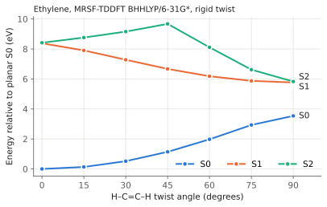

# Twisted Ethylene with MRSF-TDDFT

Twisting ethylene about its C=C bond breaks the π bond. At 90° the π and π\*
orbitals have the same energy and the ground state becomes a diradical. A
method built on one closed-shell determinant cannot describe this ground state.
MRSF-TDDFT obtains the ground and excited states together from a high-spin
triplet reference, so the same input works at every twist angle.

<div class="oqp-figs" markdown>
<figure markdown>

<figcaption>Planar ethylene (0°)</figcaption>
</figure>
<figure markdown>

<figcaption>Twisted ethylene (90°), all bond lengths unchanged</figcaption>
</figure>
</div>

## Copy and run

Planar ethylene at its PBE0/6-31G* geometry:

```text title="ethylene-planar.oqp"
mrsf(nstate=3)/bhhlyp/6-31g*
geom="""
C      0.000000     0.000000     0.664311
C      0.000000     0.000000    -0.664311
H      0.000000     0.923944     1.237411
H      0.000000    -0.923944     1.237411
H      0.000000     0.923944    -1.237411
H      0.000000    -0.923944    -1.237411
"""
```

[Download ethylene-planar.oqp](inputs/ethylene-planar.oqp)

The same molecule with one CH₂ group rotated by 90°:

```text title="ethylene-twisted.oqp"
mrsf(nstate=3)/bhhlyp/6-31g*
geom="""
C      0.000000     0.000000     0.664311
C      0.000000     0.000000    -0.664311
H      0.000000     0.923944     1.237411
H      0.000000    -0.923944     1.237411
H      0.923944     0.000000    -1.237411
H     -0.923944     0.000000    -1.237411
"""
```

[Download ethylene-twisted.oqp](inputs/ethylene-twisted.oqp)

```bash
openqp ethylene-planar.oqp
openqp ethylene-twisted.oqp
```

`mrsf(nstate=3)` requests three singlet states, S0, S1, and S2. BHHLYP is the
functional most commonly used with MRSF-TDDFT. OpenQP builds
the required high-spin ROHF triplet reference automatically. Each run takes
about 3 seconds.

## What you get

The `ENERGIES AND STATES` block of each log lists the states. For planar
ethylene:

```text
   PyOQP triplet ROHF reference (internal)  -78.3689760267
   PyOQP S0                                 -78.5257616296
   PyOQP S1                                 -78.2178196463
   PyOQP S2                                 -78.2165027669
```

and for twisted ethylene:

```text
   PyOQP triplet ROHF reference (internal)  -78.4201554151
   PyOQP S0                                 -78.3957310053
   PyOQP S1                                 -78.3138521561
   PyOQP S2                                 -78.3115552147
```

The first line is the triplet reference used internally to build the response
states; it is not one of the computed singlet states. Converted to energy
differences:

| Quantity | Planar (0°) | Twisted (90°) |
| --- | --- | --- |
| S0 → S1 vertical excitation | 8.38 eV | 2.23 eV |
| S0 → S2 vertical excitation | 8.42 eV | 2.29 eV |
| S0 energy relative to planar S0 | 0 | 3.54 eV |

## The twist curve

Repeating the calculation every 15° gives the potential-energy curves below. The
bond lengths and H–C–H angles are kept fixed, so this is a rigid twist; the
relaxed barrier is lower.



The dashed curve is the S0 energy from CASSCF(2,2) with the same basis set at
the same geometries, with two electrons in the π and π\* orbitals. At 90° it
lies 3.20 eV above its planar value, compared with 3.54 eV for MRSF-TDDFT S0;
the two methods agree on the shape of the curve, while CASSCF(2,2) lacks the
dynamic correlation that MRSF-TDDFT includes through the functional. The
CASSCF input for 90° is

```text title="ethylene-twisted-casscf.oqp"
casscf/6-31g* cas(active_electrons=2,active_orbitals=2)
geom="""
C      0.000000     0.000000     0.664311
C      0.000000     0.000000    -0.664311
H      0.000000     0.923944     1.237411
H      0.000000    -0.923944     1.237411
H     -0.923944     0.000000    -1.237411
H      0.923944     0.000000    -1.237411
"""
```

[Download ethylene-twisted-casscf.oqp](inputs/ethylene-twisted-casscf.oqp);
for the other angles, use the scan script below with this first line.

| Twist | S0 (eV) | S1 (eV) | S2 (eV) |
| --- | --- | --- | --- |
| 0° | 0.000 | 8.380 | 8.415 |
| 15° | 0.132 | 7.903 | 8.762 |
| 30° | 0.518 | 7.280 | 9.159 |
| 45° | 1.142 | 6.670 | 9.673 |
| 60° | 1.976 | 6.182 | 8.110 |
| 75° | 2.933 | 5.872 | 6.619 |
| 90° | 3.538 | 5.766 | 5.829 |

All energies are relative to S0 of planar ethylene. S0 rises as the π bond
breaks, while S1 falls, and the S0–S1 gap closes from 8.4 eV to 2.2 eV. This
smooth, continuous description of S0 near a broken bond is what MRSF-TDDFT is
used for in photochemistry, for example in searches for conical intersections
(see [BaekA Multistate MECI](../workflows/baeka-multistate-meci.md)). The S2
curve changes character between 45° and 75°; with the 6-31G* basis set, the
upper states mix valence and Rydberg-like character and should be interpreted
with care.

To make the scan inputs, this Python script writes one `.oqp` file per angle by
rotating the two hydrogen atoms on the second carbon about the C=C axis:

```python
import math

base = [("C", 0.0, 0.0, 0.664311), ("C", 0.0, 0.0, -0.664311),
        ("H", 0.0, 0.923944, 1.237411), ("H", 0.0, -0.923944, 1.237411),
        ("H", 0.0, 0.923944, -1.237411), ("H", 0.0, -0.923944, -1.237411)]

for deg in range(0, 91, 15):
    t = math.radians(deg)
    lines = []
    for i, (el, x, y, z) in enumerate(base):
        if i >= 4:  # hydrogens on the second carbon
            x, y = x * math.cos(t) - y * math.sin(t), x * math.sin(t) + y * math.cos(t)
        lines.append(f"{el} {x:12.6f} {y:12.6f} {z:12.6f}")
    with open(f"twist{deg:02d}.oqp", "w") as f:
        f.write("mrsf(nstate=3)/bhhlyp/6-31g*\ngeom=\"\"\"\n" + "\n".join(lines) + "\n\"\"\"\n")
```

```bash
for f in twist*.oqp; do openqp "$f"; done
```

## Try next

- Add `energy(T0)` to compute the triplet states,
  `mrsf(nstate=3)/bhhlyp/6-31g* energy(T0)`. For the twisted input, T0 is
  −78.3961121 hartree, 0.010 eV below S0, as expected for a diradical.
- Replace the first line with `tddft(nstate=3)/bhhlyp/6-31g*` to use ordinary
  TDDFT from the closed-shell ground state. At 0° it works; at 90° the
  closed-shell reference is no longer a good description of S0, and in our test
  run the lowest root fell to 0.43 eV and the Davidson solver stopped without
  converging.

See also: [MRSF-TDDFT](../workflows/mrsf-tddft.md),
[Spin-orbit coupling example](formaldehyde-soc.md).
