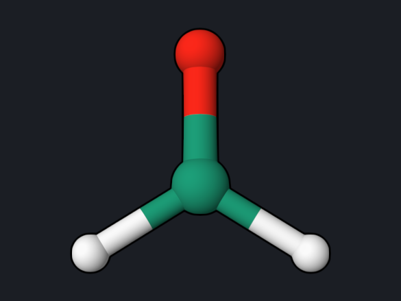
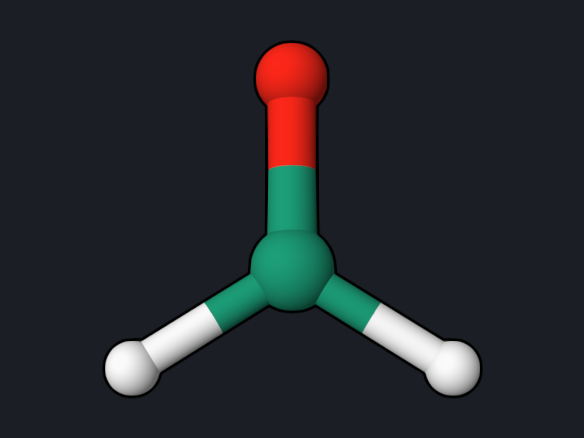
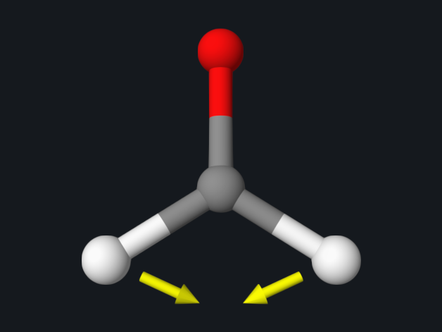
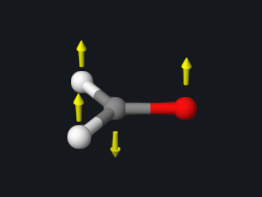
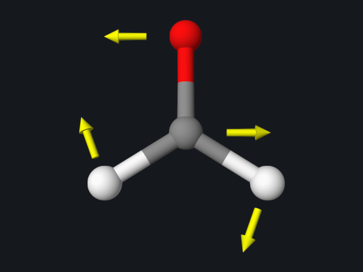
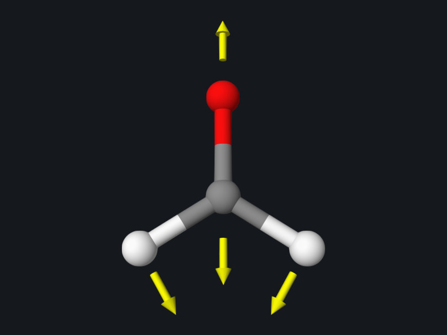
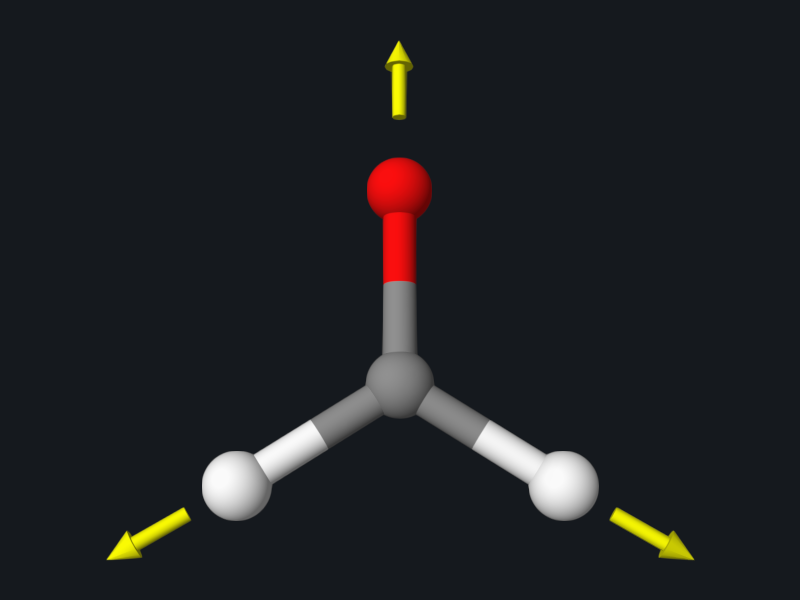
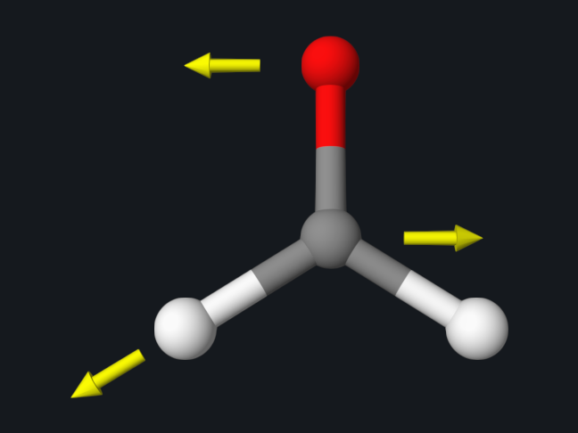
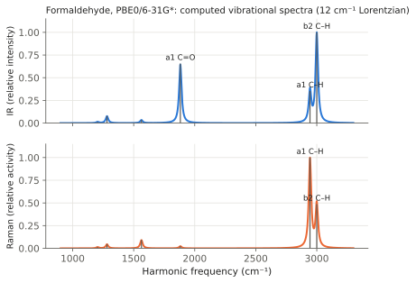

# Formaldehyde: Geometry Optimization and Vibrations

This example takes formaldehyde from a rough starting structure to its
equilibrium geometry, then computes the harmonic vibrational frequencies, the
zero-point energy, and the enthalpy and Gibbs free energy at 298.15 K. These two
steps are the usual start of any reaction-energy or spectroscopy study.

<div class="oqp-figs" markdown>
<figure markdown>

<figcaption>Rough starting structure</figcaption>
</figure>
<figure markdown>

<figcaption>Optimized PBE0/6-31G* structure</figcaption>
</figure>
<figure markdown>

<figcaption>Normal mode 4 (a1, 1882 cm⁻¹): mainly C=O stretching</figcaption>
</figure>
</div>

## Step 1: optimize the geometry

```text title="formaldehyde-opt.oqp"
dft/pbe0/6-31g* opt
geom="""
C      0.000000     0.000000    -0.530000
O      0.000000     0.000000     0.680000
H      0.000000     0.940000    -1.120000
H      0.000000    -0.940000    -1.120000
"""
```

[Download formaldehyde-opt.oqp](inputs/formaldehyde-opt.oqp)

```bash
openqp formaldehyde-opt.oqp
```

`opt` asks for a ground-state geometry optimization; the convergence criteria
and step control are defaults. The run takes about 6 seconds and writes the
step table to `opt_status.txt`:

```text
 Step           Energy            Shift      RMSD Step       Max Step      RMSD Grad       Max Grad
----------------------------------------------------------------------------------------------------------------------
    1    -114.36792361    -114.36792361       0.000000       0.000000       0.005160       0.012676
    2    -114.36801315      -0.00008953       0.003882       0.011249       0.000652       0.001953
    3    -114.36801738      -0.00000423       0.001196       0.002725       0.000187       0.000524
    4    -114.36801804      -0.00000065       0.000672       0.001016       0.000100       0.000291
    5    -114.36801809      -0.00000005       0.000169       0.000341       0.000017       0.000045
```

The log reports `PyOQP: Geometry Optimization Has Converged`, and the final
structure is written to `opt.xyz`. Gradients are in hartree/bohr and steps in
ångström.

| Quantity | Reference value |
| --- | --- |
| Final energy | −114.3680181 hartree |
| Optimization steps | 5 |
| r(C=O) | 1.2025 Å |
| r(C–H) | 1.1097 Å |
| ∠H–C–H | 115.33° |

## Step 2: frequencies and thermochemistry

Use the optimized coordinates from `opt.xyz`. Frequencies are meaningful only
at a stationary point, so always optimize first with the same method and basis
set.

```text title="formaldehyde-freq.oqp"
dft/pbe0/6-31g* hess(S0,type=analytical) ir raman
geom="""
C      0.000000     0.000000    -0.526342
O      0.000000     0.000000     0.676110
H      0.000000     0.937620    -1.119884
H      0.000000    -0.937620    -1.119884
"""
```

[Download formaldehyde-freq.oqp](inputs/formaldehyde-freq.oqp)

```bash
openqp formaldehyde-freq.oqp
```

`hess(S0,type=analytical)` computes the analytic second derivatives of the
ground-state energy. `ir raman` also requests the dipole and polarizability
derivatives. The run takes about 12 seconds.

| Mode | Symmetry | Frequency (cm⁻¹) | Motion | Experiment (cm⁻¹) |
| --- | --- | --- | --- | --- |
| 1 | b1 | 1203.45 | out-of-plane wag | 1167 |
| 2 | b2 | 1281.24 | CH₂ rock | 1249 |
| 3 | a1 | 1563.39 | CH₂ scissor | 1500 |
| 4 | a1 | 1882.16 | C=O stretch | 1746 |
| 5 | a1 | 2944.35 | symmetric C–H stretch | 2782 |
| 6 | b2 | 2999.92 | antisymmetric C–H stretch | 2843 |

<div class="oqp-figs" markdown>
<figure markdown>

<figcaption>1 · b1 · 1203 cm⁻¹ · out-of-plane wag</figcaption>
</figure>
<figure markdown>

<figcaption>2 · b2 · 1281 cm⁻¹ · CH₂ rock</figcaption>
</figure>
<figure markdown>

<figcaption>3 · a1 · 1563 cm⁻¹ · CH₂ scissor</figcaption>
</figure>
<figure markdown>

<figcaption>4 · a1 · 1882 cm⁻¹ · C=O stretch</figcaption>
</figure>
<figure markdown>

<figcaption>5 · a1 · 2944 cm⁻¹ · symmetric C–H stretch</figcaption>
</figure>
<figure markdown>

<figcaption>6 · b2 · 3000 cm⁻¹ · antisymmetric C–H stretch</figcaption>
</figure>
</div>

The arrows show the direction in which each atom moves in the normal mode (the
out-of-plane wag is viewed from the side).

The experimental values are the observed gas-phase fundamentals. Computed
harmonic frequencies are systematically higher, because the calculation omits
anharmonicity; a scale factor of about 0.95 is commonly applied before comparison
with experiment.

All six frequencies are real (positive), so the optimized structure is a minimum.
A negative value in this table would mean an imaginary frequency, that is, a
saddle point; see [the transition-state example](hcn-isomerization.md).

The thermochemistry block at the end of the log gives, at 298.15 K and 1 atm:

| Quantity | Reference value |
| --- | --- |
| Zero-point energy | 0.02705217 hartree (16.98 kcal/mol) |
| Enthalpy H | −114.33715582 hartree |
| Entropy term T·S | 0.02481901 hartree |
| Gibbs free energy G | −114.36197483 hartree |

## IR and Raman spectra



Both spectra are normalized to their strongest band, so they show relative
intensities only. The two techniques highlight different modes: in IR the
antisymmetric C–H stretch and the C=O stretch are the strongest bands, while in
Raman the symmetric C–H stretch dominates.

The absolute values are in the log:

```text
   Mode  Symmetry     Frequency(cm-1)      IR(km/mol)      Raman(bohr^4/amu)
      1        b1           1203.45         2.036547            26.254348
      2        b2           1281.24        12.121916            89.365011
      3        a1           1563.39         5.314512           181.220376
      4        a1           1882.16       102.561925            47.219241
      5        a1           2944.35        55.281427          1953.035868
      6        b2           2999.92       156.454211           949.575196
```

| Mode | IR intensity (km/mol) | PySCF 2.13 (km/mol) |
| --- | --- | --- |
| 1 · out-of-plane wag | 2.04 | 2.04 |
| 2 · CH₂ rock | 12.1 | 12.1 |
| 3 · CH₂ scissor | 5.31 | 5.40 |
| 4 · C=O stretch | 102.6 | 102.5 |
| 5 · symmetric C–H stretch | 55.3 | 55.3 |
| 6 · antisymmetric C–H stretch | 156.5 | 156.3 |

!!! note "IR intensities in OpenQP 1.3.1 and earlier"
    Builds before
    [openqp#533](https://github.com/Open-Quantum-Platform/openqp/pull/533)
    (merged 20 October 2026) print an `IR(km/mol)` column that is 23.07 times
    too small, because the conversion factor for (D/Å)²/amu was applied to
    atomic-unit dipole derivatives, and label the Raman column `Raman(activity)`.
    Relative intensities and all other values are the same. The absolute values
    above come from GitHub `main` commit `0b75a06`, which includes the fix.

## Look at the vibrations

The run writes `formaldehyde-freq.freq.molden` and
`formaldehyde-freq.hess.json`. Open either file in [OQP Studio](../studio/analysis.md)
Analysis or [OpenqpView](https://open-quantum-platform.github.io/OpenqpView/)
to animate each normal mode; the C=O stretching mode is shown above.

## Cross-check

PySCF 2.13 (PBE0/6-31G* with Cartesian d functions, analytic Hessian) at the
same geometry gives frequencies within 2 cm⁻¹ of the values above, and IR
intensities from finite-difference dipole derivatives within 2 % (table above).
The small differences come from the DFT integration grid.

## Try next

- Start the optimization from your own guess, for example a structure with
  r(C=O) = 1.4 Å, and see how many steps it needs.

See also: [Optimization](../workflows/optimization.md),
[Hessian and Frequencies](../workflows/hessian.md),
[Orbital and Vibrational Output](../workflows/orbital-vibrational-output.md).
