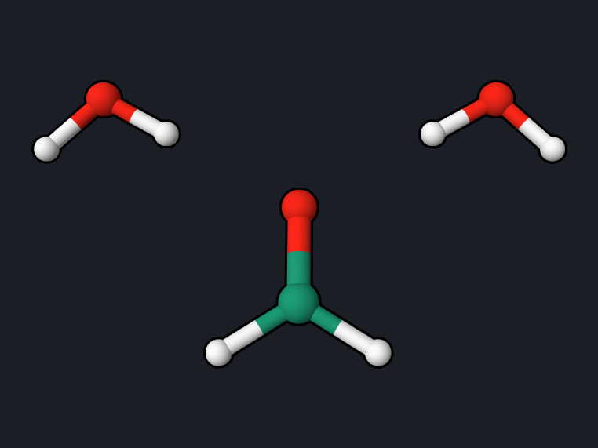
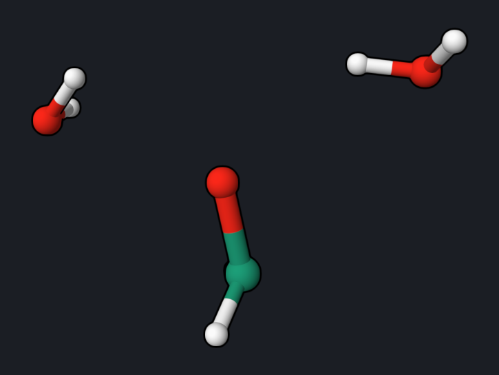

# Formaldehyde in Water: QM/MM Excited-State Dynamics

This example combines the [QM/MM model](formaldehyde-qmmm.md) with
[surface-hopping dynamics](ethylene-namd.md): formaldehyde (QM, MRSF-TDDFT) is
excited to its n→π\* state S1 while hydrogen-bonded to two TIP3P waters (MM),
and both the QM molecule and the waters move for 100 fs. The trajectory shows
how the excited molecule changes shape and how its hydrogen bonds respond.

<div class="oqp-figs" markdown>
<figure markdown>

<figcaption>t = 0 fs: planar formaldehyde, two waters H-bonded to O</figcaption>
</figure>
<figure markdown>

<figcaption>t = 100 fs: pyramidalized formaldehyde, waters moved away</figcaption>
</figure>
</div>

## Copy and run

Download the input and the three structure and force-field files of the
[QM/MM example](formaldehyde-qmmm.md) into one folder:
[formaldehyde-qmmm-namd.oqp](inputs/formaldehyde-qmmm-namd.oqp),
[formaldehyde_2water.pdb](inputs/formaldehyde_2water.pdb),
[formaldehyde.xml](inputs/formaldehyde.xml), and
[tip3p.xml](inputs/tip3p.xml). OpenMM is required (`pip install openmm`).

```text title="formaldehyde-qmmm-namd.oqp"
mrsf(nstate=3)/bhhlyp/6-31g* namd(S1,scheme=BaeckAn) md(nstep=200,dt=0.5,temperature=300,seed=5)
qmmm(forcefield_files="formaldehyde.xml tip3p.xml",qm_atoms="0-3",cutoff=NoCutoff)
geom="formaldehyde_2water.pdb"
```

```bash
openqp formaldehyde-qmmm-namd.oqp
```

Compared with the [single-structure QM/MM run](formaldehyde-qmmm.md), only
`md(...)` changes: 200 steps of 0.5 fs with initial velocities for all ten atoms
drawn at 300 K (`seed=5` makes the run reproducible). `namd(S1,...)` starts the
trajectory on S1 and allows hops among the three states. The run takes about
5 minutes with 8 threads.

## What you get

Each step prints one line to the log, marked `QMMM-NAMD`:

```text
   QMMM-NAMD step      0  t=    0.000 fs  active=2  E_tot=-114.26382638  E_pot=-114.27380184 ...
   QMMM-NAMD step    200  t=  100.000 fs  active=2  E_tot=-114.26386569  E_pot=-114.28477464 ...
```

`active=2` means S1 (1 = S0). The full trajectory is in
`formaldehyde-qmmm-namd.namd.trj`, with the coordinates of all QM and MM atoms;
read it with `read_namd_trajectory` as shown in the
[ethylene NAMD example](ethylene-namd.md).


| Quantity | Reference trajectory |
| --- | --- |
| Active state | S1 for all 100 fs (no hops) |
| Total-energy range | 8.8 × 10⁻⁵ hartree (0.002 eV) |
| r(C=O) | oscillates between 1.19 and 1.48 Å (1.20 Å at the start) |
| Out-of-plane angle of O | 0° at the start, between 22 and 49° after 10 fs |
| O···H hydrogen bonds | 1.95 Å at the start, 2.60 and 2.85 Å at 100 fs |
| S1 − S0 gap | 4.21 eV at the start, between 1.3 and 3.8 eV afterwards |

## Reading the result

- **The excited molecule changes shape.** In the n→π\* state one electron
  moves from the oxygen lone pair into the C=O π\* orbital. The C=O bond
  weakens and starts a large stretching vibration, and the molecule
  pyramidalizes within 20 fs. Both are known features of the S1 state of
  formaldehyde, whose equilibrium structure is pyramidal with a longer C=O bond.
- **The hydrogen bonds break.** With one electron removed from the lone pair,
  the oxygen is a weaker hydrogen-bond acceptor, and both waters drift away from
  1.95 to 2.6–2.9 Å within 100 fs. This is the dynamical counterpart of the
  blue shift in the [QM/MM example](formaldehyde-qmmm.md): the solvent
  stabilizes S0 more than S1.
- **The gap oscillates with the C=O stretch** and does not close. S1 of
  formaldehyde does not reach a crossing with S0 on this timescale, so no hop
  occurs; formaldehyde's S1 is long-lived compared with this simulation.
- One trajectory with two waters is an illustration. A solvated simulation needs
  a full solvent box and an ensemble of trajectories from sampled initial
  conditions.

## Try next

- Run the same trajectory without `qmmm(...)` and with the formaldehyde
  coordinates only, and compare the pyramidalization.
- Add more waters around the molecule in the PDB file, or use the larger
  repository systems in
  [`examples/QMMM`](https://github.com/Open-Quantum-Platform/openqp/tree/main/examples/QMMM),
  which also show restraints that keep the solvent together.

See also: [SOC-NAMD-QMMM](../workflows/soc-namd-qmmm.md),
[`qmmm`](../keywords/qmmm.md), [NAMD coupling schemes](../keywords/md-schemes.md).
