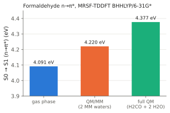

# Formaldehyde in Water: QM/MM Solvent Shift

In QM/MM, a small quantum (QM) region is embedded in a classical (MM)
environment. Here formaldehyde is the QM region, and two water molecules that
hydrogen-bond to its oxygen are TIP3P point charges. The example computes how
the environment shifts the n→π\* excitation energy, and checks the QM/MM
result against a calculation that treats the whole cluster quantum
mechanically.

<div class="oqp-figs" markdown>
<figure markdown>

<figcaption>Formaldehyde (QM) with two hydrogen-bonded waters (MM), O···H = 1.95 Å</figcaption>
</figure>
</div>



## Requirements

QM/MM uses the OpenMM library for the MM part. Install it into the same Python
environment as OpenQP:

```bash
pip install openmm
```

The reference values were produced with OpenMM 8.3.1.

## Copy and run

QM/MM needs the structure as a PDB file and the force-field files. Download all
four files into one folder:

- [formaldehyde-qmmm.oqp](inputs/formaldehyde-qmmm.oqp), the input
- [formaldehyde_2water.pdb](inputs/formaldehyde_2water.pdb), formaldehyde (atoms 0–3) and two waters
- [formaldehyde.xml](inputs/formaldehyde.xml), Lennard-Jones parameters for the QM molecule
- [tip3p.xml](inputs/tip3p.xml), the TIP3P water model

```text title="formaldehyde-qmmm.oqp"
mrsf(nstate=3)/bhhlyp/6-31g* namd(S1,scheme=BaeckAn) md(nstep=1,dt=0.5,velocity=zero)
qmmm(forcefield_files="formaldehyde.xml tip3p.xml",qm_atoms="0-3",cutoff=NoCutoff)
geom="formaldehyde_2water.pdb"
```

```bash
openqp formaldehyde-qmmm.oqp
```

- `qmmm(...)`: `qm_atoms="0-3"` makes the first four PDB atoms (0-based) the QM
  region; everything else is MM. `cutoff=NoCutoff` includes all MM charges.
- The PDB file is the geometry. OpenQP builds the QM molecule from the
  selected atoms.
- `namd(S1,...) md(nstep=1,dt=0.5,velocity=zero)`: in OpenQP 1.3.1 the
  electrostatic embedding is built by the QM/MM dynamics and optimization
  drivers, not by a plain single-point energy. A single step started at rest is
  the supported way to obtain the embedded energies of all three states at this
  structure. The log notes that the ESPF embedding charges are taken from the
  relaxed density of the active state, S1.

The run takes about 5 seconds.

For comparison, the same formaldehyde coordinates in the gas phase
([formaldehyde-gas.oqp](inputs/formaldehyde-gas.oqp)) and the full
formaldehyde + 2 water cluster treated entirely by MRSF-TDDFT
([formaldehyde-2water-qm.oqp](inputs/formaldehyde-2water-qm.oqp)):

```text title="formaldehyde-gas.oqp"
mrsf(nstate=3)/bhhlyp/6-31g*
geom="""
C      0.000000     0.000000    -0.526000
O      0.000000     0.000000     0.676000
H      0.000000     0.938000    -1.120000
H      0.000000    -0.938000    -1.120000
"""
```

## What you get

The log has one `ENERGIES AND STATES` block per step; the last one, after the
0.5 fs step, reads:

```text
   PyOQP S0                                 -115.1675366997
   PyOQP S1                                 -115.0124521978
   PyOQP S2                                 -114.8388455587
```

The absolute energies include the QM–MM interaction and are not comparable
with the gas-phase energies; the excitation energy S1 − S0 is.

| Model | S0 → S1 (n→π\*) | Shift from gas phase |
| --- | --- | --- |
| Gas phase | 4.091 eV | — |
| QM/MM, 2 TIP3P waters | 4.220 eV | +0.13 eV |
| Full QM, formaldehyde + 2 waters | 4.377 eV | +0.29 eV |

In all three runs S1 is the dark A2 n→π\* state (zero transition dipole), so
the numbers describe the same excitation. The log also prints an excited-state
summary table at each step; the first one, at the input structure before the
atoms move, gives 4.215 eV:

```text
    S1   -115.0129908096     0.995496     4.214970      0.007    -0.0000     0.0000     0.0002     0.0002      0.0000
```

## Reading the result

- **The excitation is blue-shifted.** The water hydrogens bind to the oxygen
  lone pair n, lowering its energy. Exciting an electron out of n therefore
  costs more in the hydrogen-bonded complex than in the gas phase.
- **Point charges give about half of the shift here.** The QM/MM model
  represents the waters only by fixed charges (and Lennard-Jones terms), while
  the full QM cluster also includes the polarization of the waters and the
  exchange and charge-transfer interactions at 1.95 Å. For quantitative work,
  include the first-shell waters in the QM region and keep more distant
  solvent as MM.
- Two waters at one fixed structure are a model, not a solution: a solvent
  shift for comparison with experiment needs averaging over many solvent
  configurations, for example snapshots from QM/MM dynamics.

## Try next

- Add more TIP3P waters to the PDB file around the molecule and watch the
  QM/MM shift change.
- Run ground-state QM/MM dynamics with `md(...)` and the same `qmmm(...)` call
  (see the [qmmm keyword page](../keywords/qmmm.md)), then compute the shift on
  several snapshots.

See also: [`qmmm`](../keywords/qmmm.md),
[SOC-NAMD-QMMM](../workflows/soc-namd-qmmm.md),
[repository QM/MM examples](../examples/index.md#qmmm-examples).
