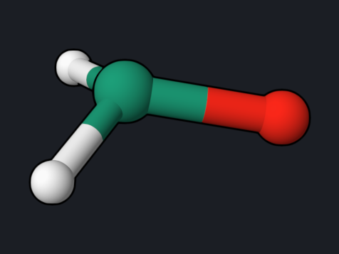

# Formaldehyde: Excited-State Geometry, Absorption, and Emission

Optimizing a molecule on an excited state gives its relaxed excited-state
structure and, from that structure, the emission energy. Together with the
ground-state minimum this yields the three numbers that describe a band in
absorption and fluorescence spectra: the vertical absorption, the vertical
emission, and the adiabatic (0–0) energy. This example does both optimizations
for formaldehyde with MRSF-TDDFT.

<div class="oqp-figs" markdown>
<figure markdown>

<figcaption>S0 minimum: planar</figcaption>
</figure>
<figure markdown>

<figcaption>S1 minimum: pyramidal, C–O stretched to 1.313 Å</figcaption>
</figure>
</div>


## Step 1: optimize the ground state

```text title="formaldehyde-s0-mrsf-opt.oqp"
mrsf(nstate=3)/bhhlyp/6-31g* opt(S0)
geom="""
C      0.000000     0.000000    -0.526342
O      0.000000     0.000000     0.676110
H      0.000000     0.937620    -1.119884
H      0.000000    -0.937620    -1.119884
"""
```

[Download formaldehyde-s0-mrsf-opt.oqp](inputs/formaldehyde-s0-mrsf-opt.oqp)

`opt(S0)` optimizes the MRSF-TDDFT ground state, so both optimizations use
the same method. The run converges in 6 steps (about 7 seconds).

## Step 2: optimize the first excited singlet

```text title="formaldehyde-s1-opt.oqp"
mrsf(nstate=3)/bhhlyp/6-31g* opt(S1)
geom="""
C      0.000000     0.000000    -0.526342
O      0.150000     0.000000     0.676110
H      0.000000     0.937620    -1.119884
H      0.000000    -0.937620    -1.119884
"""
```

[Download formaldehyde-s1-opt.oqp](inputs/formaldehyde-s1-opt.oqp)

`opt(S1)` follows the physical first excited singlet, using analytic MRSF-TDDFT
gradients. The oxygen atom starts 0.15 Å out of the plane, so the optimizer is
not held at the planar structure by symmetry; the S1 minimum is pyramidal. The run converges in 10 steps (about
11 seconds):

```text
    9    -114.28784263      -0.00001059       0.003241       0.005782       0.000344       0.000798
   10    -114.28784362      -0.00000100       0.000815       0.001699       0.000058       0.000153
```

## What you get

The `ENERGIES AND STATES` block at the end of each run gives S0 and S1 at the
optimized geometry:

| Structure | E(S0) (hartree) | E(S1) (hartree) |
| --- | --- | --- |
| S0 minimum | −114.4224437 | −114.2636198 |
| S1 minimum | −114.3767751 | −114.2878436 |

| Quantity | MRSF-TDDFT | Experiment |
| --- | --- | --- |
| Vertical absorption, S1 − S0 at the S0 minimum | 4.32 eV | about 4.1 eV (band maximum) |
| Vertical emission, S1 − S0 at the S1 minimum | 2.42 eV | — |
| Adiabatic 0–0 energy (without zero-point correction) | 3.66 eV | 3.49 eV |
| r(C–O) at S0 / S1 minimum | 1.178 / 1.313 Å | 1.208 / 1.32 Å |
| Out-of-plane angle of O at the S1 minimum | 38° | 34° |

## Reading the result

- **The n→π\* state changes the shape.** Moving one electron from the oxygen
  lone pair into the C=O π\* orbital weakens the C–O bond, which lengthens by
  0.13 Å, and the molecule becomes pyramidal. The same changes appear in the
  first femtoseconds of the [QM/MM dynamics example](formaldehyde-qmmm-namd.md).
- **Absorption and emission differ by 1.9 eV.** The relaxation on S1 lowers S1
  by 0.66 eV and raises S0 at that geometry by 1.24 eV, a large Stokes shift for
  such a small molecule.
- The experimental 0–0 energy includes zero-point vibrational energy; add the
  difference of the S1 and S0 zero-point energies from Hessian runs for a
  direct comparison.

## Try next

- Use `opt(T0)` with the same input to optimize the lowest triplet.
- Repeat with TDDFT, `tddft(nstate=3)/pbe0/6-31g* opt(S1)`, and compare the
  geometry.

See also: [Optimization](../workflows/optimization.md),
[MRSF-TDDFT](../workflows/mrsf-tddft.md).
