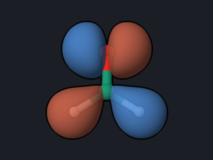
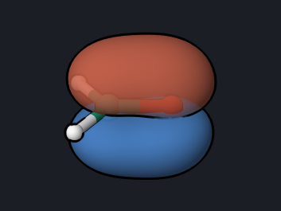
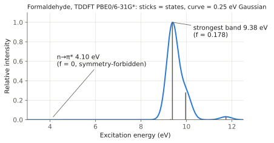

# Formaldehyde: UV Absorption with TDDFT

Linear-response TDDFT gives vertical excitation energies and oscillator
strengths, which together form a computed absorption spectrum. Formaldehyde has
a weak, symmetry-forbidden n→π* band in the near UV; this example shows how to
find it and identify the orbitals involved.

<div class="oqp-figs" markdown>
<figure markdown>

<figcaption>HOMO, orbital 8 (b2): oxygen lone pair n</figcaption>
</figure>
<figure markdown>

<figcaption>HOMO−1, orbital 7 (b1): C=O π</figcaption>
</figure>
<figure markdown>

<figcaption>LUMO, orbital 9 (b1): C=O π*</figcaption>
</figure>
</div>

## Copy and run

```text title="formaldehyde-uv.oqp"
tddft(nstate=6)/pbe0/6-31g*
geom="""
C      0.000000     0.000000    -0.526342
O      0.000000     0.000000     0.676110
H      0.000000     0.937620    -1.119884
H      0.000000    -0.937620    -1.119884
"""
```

[Download formaldehyde-uv.oqp](inputs/formaldehyde-uv.oqp)

```bash
openqp formaldehyde-uv.oqp
```

`tddft(nstate=6)` requests the six lowest singlet excited states from the
closed-shell PBE0 ground state; the full linear-response (RPA) equations are
solved by default. The geometry is the PBE0/6-31G* minimum from the
[optimization example](formaldehyde-opt-freq.md). The run takes about 4 seconds.

## What you get

The log ends the excited-state part with a summary table. `DX`, `DY`, and `DZ`
are the transition-dipole components in atomic units:

```text
  Transition          dE(eV)          DX          DY          DZ      Osc.str.
   0 -> 1            4.104380      0.0000      0.0000      0.0000      0.0000
   0 -> 2            9.299532     -0.0740      0.0000      0.0000      0.0012
   0 -> 3            9.382229     -0.0000     -0.8790      0.0000      0.1776
   0 -> 4            9.965700      0.0000     -0.0000      0.4516      0.0498
   0 -> 5           10.450864     -0.0000      0.0000      0.0000      0.0000
   0 -> 6           11.735688      0.0000     -0.1401     -0.0000      0.0056
```

The `ENERGIES AND STATES` block lists the total energy of each state; the
ground state is −114.3680181 hartree and state 1 is −114.2171849 hartree.



The spectrum above is drawn from the table: each state is a stick of height
proportional to its oscillator strength, and the curve is a 0.25 eV Gaussian
broadening of the sticks.

## Reading the result

- **State 1 at 4.10 eV is the n→π\* state.** Its transition dipole is zero in
  every direction, so it is dark (f = 0). The excitation moves an electron from
  the oxygen lone pair n (b2) to the C=O π\* orbital (b1). The product b2 × b1 =
  a2, and an A2 state has no allowed electric-dipole transition from the A1
  ground state in C2v. In experiment the band is weak but visible near 4 eV,
  because vibrations break the symmetry.
- **States 2–6 lie above 9 eV.** Real formaldehyde has Rydberg states from about
  7 eV. The 6-31G* basis set has no diffuse functions, so it cannot describe
  these states, and the computed upper states should not be compared with
  experiment. Use `aug-cc-pvdz` or larger for that region.
- The direction of each transition dipole gives the state symmetry: x
  (out of plane) means B1, y (in plane, perpendicular to C=O) means B2, and z
  (along C=O) means A1.

## Cross-check

PySCF 2.13 TDDFT (PBE0/6-31G* with Cartesian d functions) at the same geometry
gives 4.1048, 9.2996, 9.3833, 9.9660, 10.4506, and 11.7391 eV with the same
oscillator strengths to three decimals. The agreement is within 4 meV.

## Try next

- Add `energy(T0)` to compute the triplet states instead of the singlets:
  `tddft(nstate=6)/pbe0/6-31g* energy(T0)`.
- Change the basis set to `aug-cc-pvdz` and look for the Rydberg states.
- Replace `tddft` with `mrsf` and `pbe0` with `bhhlyp` to compare with
  [MRSF-TDDFT](ethylene-twist.md), which also describes the ground state
  together with the excited states.

See also: [TDDFT and TDHF](../workflows/tddft.md),
[`tdhf`](../keywords/tdhf.md).
