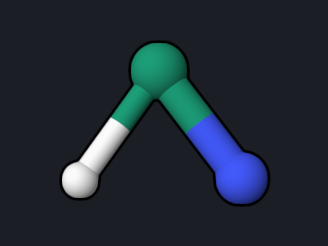
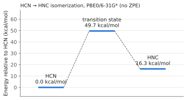

# HCN → HNC: Transition State and Barrier

Hydrogen cyanide can isomerize to hydrogen isocyanide by moving the hydrogen
from carbon to nitrogen. This example locates the transition state (TS) of that
reaction, proves that it is a TS with a frequency calculation, and computes the
barrier and the reaction energy from the two minima.

<div class="oqp-figs" markdown>
<figure markdown>

<figcaption>Transition state: the hydrogen bridges C and N</figcaption>
</figure>
<figure markdown>

<figcaption>The imaginary mode (1158i cm⁻¹) carries H between C and N</figcaption>
</figure>
</div>

## Step 1: find the transition state

Start from a bent guess with the hydrogen roughly between the two heavy atoms:

```text title="hcn-ts.oqp"
dft/pbe0/6-31g* ts(S0)
geom="""
C      0.000000     0.000000     0.000000
N      0.000000     0.000000     1.190000
H      1.100000     0.000000     0.500000
"""
```

[Download hcn-ts.oqp](inputs/hcn-ts.oqp)

```bash
openqp hcn-ts.oqp
```

`ts(S0)` searches for a first-order saddle point on the ground-state surface:
the optimizer climbs along one direction and minimizes along all the others.
The run takes about 4 seconds and converges in 9 steps:

```text
 Step           Energy            Shift      RMSD Step       Max Step      RMSD Grad       Max Grad
----------------------------------------------------------------------------------------------------------------------
    1     -93.22942672     -93.22942672       0.000000       0.000000       0.006977       0.012290
  ...
    8     -93.22809165      -0.00000149       0.000781       0.001613       0.000152       0.000291
    9     -93.22809179      -0.00000014       0.000378       0.000829       0.000044       0.000085
```

| Quantity | Reference value |
| --- | --- |
| TS energy | −93.2280918 hartree |
| r(C–N) | 1.189 Å |
| r(C–H) | 1.182 Å |
| r(N–H) | 1.394 Å |

A TS search is more sensitive to the starting structure than a minimization. A
guess far from the TS can take many more steps; it helps to place the moving
atom near its expected position.

## Step 2: confirm it is a transition state

A true TS has exactly one imaginary frequency. Run an analytic Hessian at the
converged geometry from `opt.xyz`:

```text title="hcn-ts-freq.oqp"
dft/pbe0/6-31g* hess(S0,type=analytical)
geom="""
C      0.025858     0.000000     0.022436
N     -0.050362     0.000000     1.208979
H      1.124504     0.000000     0.458585
"""
```

[Download hcn-ts-freq.oqp](inputs/hcn-ts-freq.oqp)

```text
   Mode  Symmetry     Frequency(cm-1)      IR(km/mol)        Raman(activity)
      1        a'          -1158.14         3.401775            59.221228
      2        a'           2098.48         0.344450           242.971350
      3        a'           2676.92         5.253824           491.302998
```

OpenQP prints imaginary frequencies as negative numbers. Mode 1, −1158 cm⁻¹,
is the only one, and its normal mode (shown above) moves the hydrogen from
carbon toward nitrogen. This is the reaction coordinate. (The `IR(km/mol)`
column of OpenQP 1.3.1 is about 23 times too small; see the
[frequency example](formaldehyde-opt-freq.md).)

## Step 3: the two minima

```text title="hcn-min.oqp"
dft/pbe0/6-31g* opt
geom="""
C      0.000000     0.000000     0.000000
N      0.000000     0.000000     1.160000
H      0.000000     0.000000    -1.070000
"""
```

```text title="hnc-min.oqp"
dft/pbe0/6-31g* opt
geom="""
C      0.000000     0.000000     0.000000
N      0.000000     0.000000     1.170000
H      0.000000     0.000000     2.170000
"""
```

[Download hcn-min.oqp](inputs/hcn-min.oqp) ·
[Download hnc-min.oqp](inputs/hnc-min.oqp)

| Structure | Energy (hartree) | Geometry |
| --- | --- | --- |
| HCN | −93.3072282 | r(C–N) 1.155 Å, r(C–H) 1.071 Å |
| TS | −93.2280918 | see above |
| HNC | −93.2812843 | r(C–N) 1.175 Å, r(N–H) 0.999 Å |



With 1 hartree = 627.5095 kcal/mol:

- **Barrier** HCN → TS: 0.0791364 hartree = **49.7 kcal/mol**
- **Reaction energy** HCN → HNC: 0.0259439 hartree = **16.3 kcal/mol**
  (HNC is less stable)

These are electronic energies without zero-point corrections. To include them,
run `hess(S0,type=analytical)` at each of the three geometries and use the
zero-point energies from the thermochemistry block, as in the
[frequency example](formaldehyde-opt-freq.md).

## Try next

- Follow the reaction path downhill from the TS with an intrinsic reaction
  coordinate run: replace the first line of `hcn-ts-freq.oqp` with
  `dft/pbe0/6-31g* irc(S0,hessian=analytical)`. The run computes up to 30 path
  points by default (about 1 minute); in the reference run the energy fell from
  the TS to −93.2719 hartree at point 30, on the way to HNC. See
  [Transition-State Searches](../workflows/transition-state-search.md) for the
  path-length and step controls.
- Compare the barrier with a larger basis set, for example `def2-tzvp`, at
  geometries reoptimized with that basis.

See also: [Transition-State Searches](../workflows/transition-state-search.md),
[Optimization](../workflows/optimization.md).
