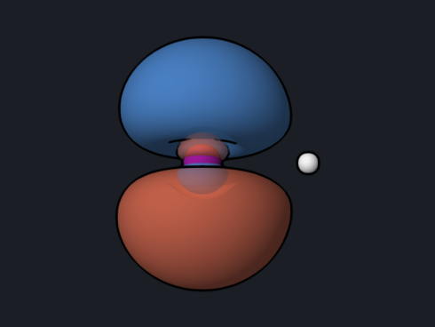

# Hydrogen Iodide: Effective Core Potentials

An effective core potential (ECP) replaces the inner electrons of a heavy
atom by a potential, so only the valence electrons are treated explicitly.
This makes calculations on heavy elements much cheaper, and an ECP fitted to
relativistic atomic calculations also brings in the scalar relativistic
effects (see the [gold hydride example](auh-relativity.md)). In OpenQP an ECP
is selected simply by choosing a basis set that comes with one, such as
def2-SVP for iodine.

<div class="oqp-figs" markdown>
<figure markdown>

<figcaption>σ bonding orbital (I 5p + H 1s); iodine on the left</figcaption>
</figure>
<figure markdown>

<figcaption>HOMO: one of the two I 5p lone pairs</figcaption>
</figure>
</div>

## Step 1: optimize the geometry

```text title="hi-opt.oqp"
dft/pbe0/def2-svp opt
geom="""
I 0.000000 0.000000 0.000000
H 0.000000 0.000000 1.600000
"""
```

[Download hi-opt.oqp](inputs/hi-opt.oqp)

```bash
openqp hi-opt.oqp
```

def2-SVP uses a 28-electron ECP for iodine: of the 53 electrons of the iodine
atom, the 1s–3d shells (28 electrons) are replaced, and the 25 electrons of the
4s, 4p, 4d, 5s, and 5p shells remain. The log
shows the reduced count and the size of the basis:

```text
     Basis Sets: def2-svp
     Number of Basis Set functions  =      31
 DFT: number of electrons    =        26
```

The optimization converges in 4 steps, in about 5 seconds:

```text
    3    -298.30701471      -0.00004109       0.006140       0.010635       0.000033       0.000057
    4    -298.30701472      -0.00000001       0.000088       0.000153       0.000000       0.000001
```

## Step 2: frequency and dipole

At the optimized geometry, an analytic Hessian works with the ECP:

```text title="hi-freq.oqp"
dft/pbe0/def2-svp hess(S0,type=analytical)
geom="""
I 0.000000 0.000000 -0.011754
H 0.000000 0.000000 1.611754
"""
```

[Download hi-freq.oqp](inputs/hi-freq.oqp) ·
[hi-dipole.oqp](inputs/hi-dipole.oqp) (same geometry, first line
`dft/pbe0/def2-svp properties(scf_prop="el_mom,mulliken")`)

`properties(...)` is not applied in a Hessian run, so the dipole moment comes
from a separate single point. Each run takes a few seconds.

## What you get

| Quantity | PBE0/def2-SVP (ECP) | Experiment |
| --- | --- | --- |
| Energy (valence electrons only) | −298.3070147 hartree | — |
| r(H–I) | 1.624 Å | 1.609 Å |
| Harmonic frequency | 2230 cm⁻¹ | 2309 cm⁻¹ |
| Zero-point energy | 0.00508 hartree | — |
| Dipole moment | 0.660 D | 0.448 D |
| Mulliken charges | I −0.088, H +0.088 | — |

## Reading the result

- **The energy is a valence-only energy.** −298.3 hartree is far from the
  all-electron energy of HI (about −6900 hartree without relativity); ECP total energies can be
  compared only with other calculations that use the same ECP. Reaction
  energies, geometries, and frequencies are what an ECP calculation is for.
- **The bond length is 0.015 Å long and the frequency 79 cm⁻¹ low** compared
  with experiment, which is typical for a double-zeta basis set; def2-TZVP
  uses the same ECP and is the natural next check.
- **The dipole is small and sensitive.** HI is only weakly polar, and the
  computed 0.660 D is 0.21 D above experiment; dipole moments usually need
  larger basis sets with diffuse functions.
- **The orbitals** come from the Molden file
  `hi-dipole_scf_rhf_pbe0_def2-svp.molden` as usual. Only the 13 valence
  orbitals are occupied; the core orbitals of iodine are not part of the
  calculation.

## Try next

- Compare HBr with def2-SVP (bromine has no ECP in def2, so all 35 electrons
  are treated) and HI with def2-TZVP.
- Use an ECP with an excited-state method: the repository contains MRSF-TDDFT
  and SF-TDDFT examples with ECPs in
  [`examples/ECP`](https://github.com/Open-Quantum-Platform/openqp/tree/main/examples/ECP).

See also: [AuH: relativistic bond contraction](auh-relativity.md),
[Examples](../examples/index.md).
