# Worked Examples

Each worked example is one small molecule, one complete `.oqp` input that you
can copy and run as it is, and the results that the run produces. The
coordinates are written inside the input, so no separate geometry file is
needed. Some examples need extra files, downloaded with them into the same
folder: the [QM/MM examples](formaldehyde-qmmm.md) read their structure and force
field from a PDB file and two OpenMM XML files, and the all-electron inputs of
the [gold hydride example](auh-relativity.md) read an uncontracted basis set
from a JSON file, the [NEB example](nh3-neb.md) reads its product structure
from an XYZ file, and the [alanine QM/MM example](alanine-qmmm.md) reads a PDB
file. Run the input, then compare your numbers with the reference values on
the page.

```bash
openqp water-scf.oqp
```

Every input on these pages can also be downloaded from the link under its code
block. With 2 to 8 CPU threads, most runs take between 2 seconds and 1
minute. These take longer:

| Example | Run time |
| --- | --- |
| HCN IRC, each direction | about 3.5 minutes |
| NH₃ NEB on the 150 × 974 DFT grid | about 7 minutes |
| Ethylene MECI search | about 3.5 minutes |
| NH₃ inversion NEB | about 7 minutes |
| Ethylene S1 minimum-energy path | about 4.5 minutes |
| Methanol ground-state MD | about 4.5 minutes |
| Formaldehyde QM/MM excited-state dynamics | about 5 minutes |
| Alanine-dipeptide QM/MM ground-state MD | about 6 minutes |
| Formaldehyde SOC-NAMD | about 2.5 minutes |
| Ethylene NAMD | about 9 minutes |
| Benzene HF/cc-pVTZ with `symmetry(enabled=false)` | about 1.5 minutes |
| Alanine-dipeptide QM/MM optimization | about 1 minute |

Each page states its run time.

<div class="oqp-gallery" markdown>

<a class="oqp-card" href="water-scf/" markdown>
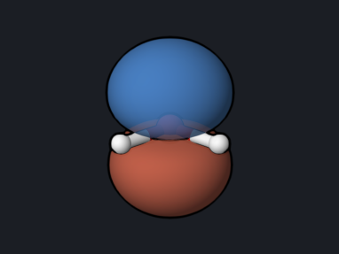
<strong>Water energy and orbitals</strong>
<span>Total energy, orbital energies, HOMO and LUMO pictures, dipole moment, and atomic charges.</span>
</a>

<a class="oqp-card" href="formaldehyde-opt-freq/" markdown>

<strong>Geometry and vibrations</strong>
<span>Optimize formaldehyde, then compute harmonic frequencies, zero-point energy, and thermochemistry.</span>
</a>

<a class="oqp-card" href="formaldehyde-uv/" markdown>
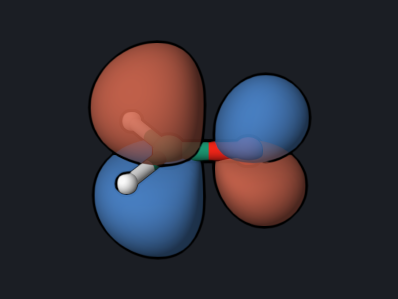
<strong>UV absorption (TDDFT)</strong>
<span>Excitation energies and oscillator strengths, and the orbitals behind the n→π* band.</span>
</a>

<a class="oqp-card" href="ethylene-twist/" markdown>
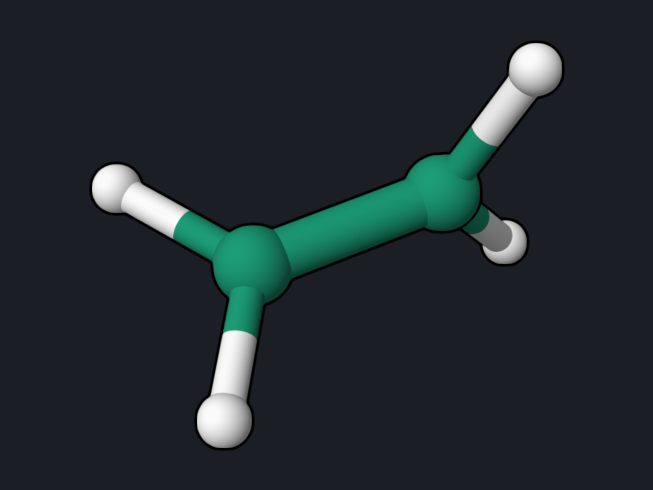
<strong>Twisted ethylene (MRSF-TDDFT)</strong>
<span>S0, S1, and S2 along the C=C twist, where S0 becomes a diradical.</span>
</a>

<a class="oqp-card" href="formaldehyde-soc/" markdown>

<strong>Spin-orbit coupling</strong>
<span>Singlet-triplet coupling matrix elements in cm⁻¹ and El-Sayed's rule.</span>
</a>

<a class="oqp-card" href="benzene-nmr/" markdown>
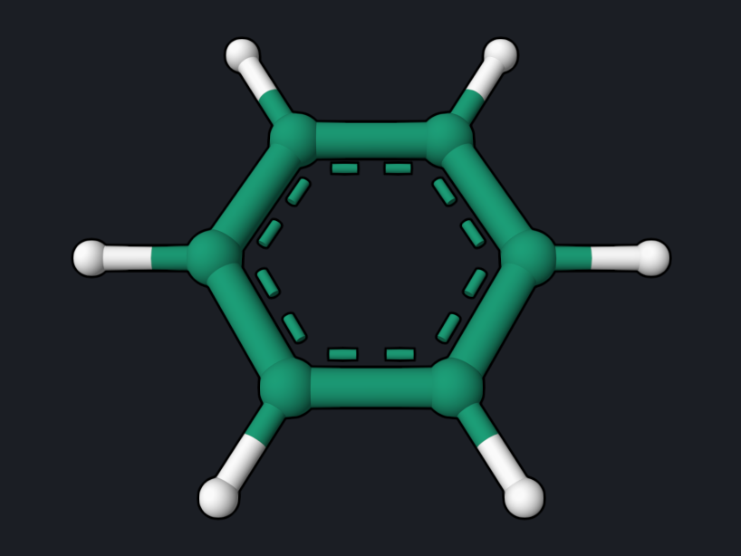
<strong>NMR chemical shifts</strong>
<span>GIAO shieldings of benzene and TMS, converted to ¹H and ¹³C chemical shifts.</span>
</a>

<a class="oqp-card" href="hcn-isomerization/" markdown>
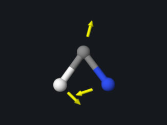
<strong>Transition state and barrier</strong>
<span>Locate the HCN → HNC transition state, confirm one imaginary frequency, and compute the barrier.</span>
</a>

<a class="oqp-card" href="water-correlation/" markdown>
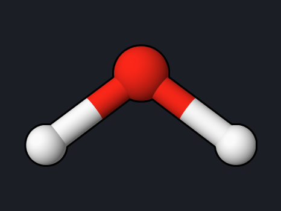
<strong>MP2 and CCSD(T) energies</strong>
<span>Correlation energies of water at the MP2 and CCSD(T) levels.</span>
</a>

<a class="oqp-card" href="h2-dissociation/" markdown>
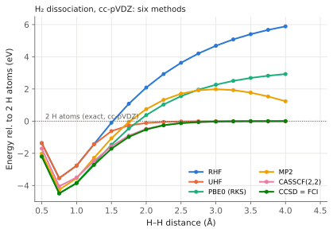
<strong>H₂ dissociation: six methods</strong>
<span>RHF, UHF, PBE0, MP2, CASSCF, and CCSD along a breaking bond.</span>
</a>

<a class="oqp-card" href="allyl-radical/" markdown>
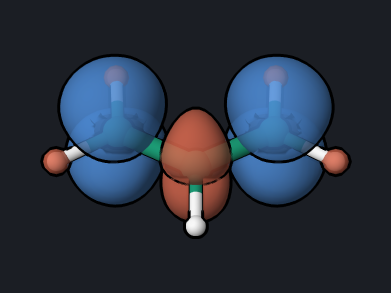
<strong>Allyl radical spin density</strong>
<span>Open-shell UKS optimization, spin populations, and spin polarization.</span>
</a>

<a class="oqp-card" href="water-ekt/" markdown>
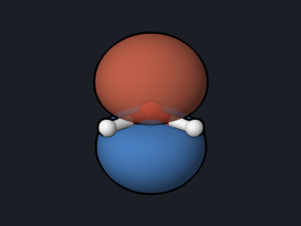
<strong>Ionization energies (MRSF-EKT)</strong>
<span>Ionization energies of water and the Dyson orbital of each ionization.</span>
</a>

<a class="oqp-card" href="benzene-acid/" markdown>
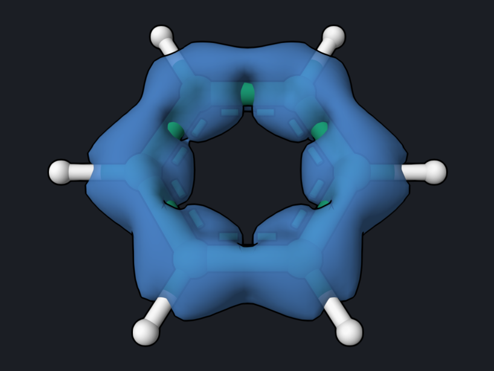
<strong>Ring current (ACID)</strong>
<span>Current-density isosurface showing the aromatic ring current of benzene.</span>
</a>

<a class="oqp-card" href="methanol-md/" markdown>
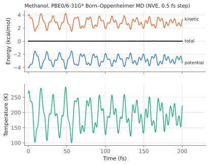
<strong>Ground-state MD</strong>
<span>200 fs of Born–Oppenheimer dynamics and an energy-conservation check.</span>
</a>

<a class="oqp-card" href="ethylene-meci/" markdown>
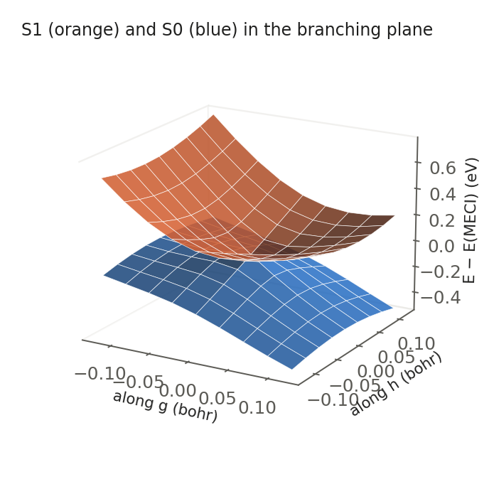
<strong>Conical intersection (MECI)</strong>
<span>Locate the S0/S1 MECI of ethylene, its g and h vectors, and the cone.</span>
</a>

<a class="oqp-card" href="ethylene-namd/" markdown>
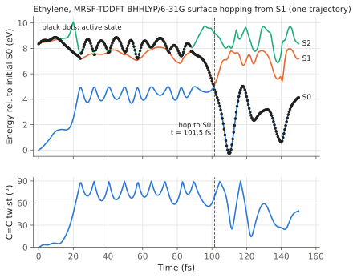
<strong>Nonadiabatic dynamics</strong>
<span>Surface hopping from S1: twisting and return to S0 in 100 fs.</span>
</a>

<a class="oqp-card" href="formaldehyde-soc-namd/" markdown>
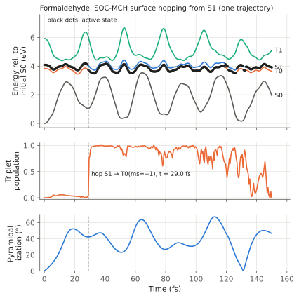
<strong>Intersystem crossing (SOC-NAMD)</strong>
<span>Surface hopping with spin-orbit coupling: formaldehyde hops from S1 to T0 after pyramidalizing (experimental).</span>
</a>

<a class="oqp-card" href="ethylene-sf-tddft/" markdown>
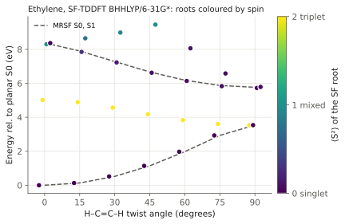
<strong>SF-TDDFT and spin contamination</strong>
<span>SF-TDDFT roots of ethylene identified by ⟨S²⟩, compared with MRSF-TDDFT.</span>
</a>

<a class="oqp-card" href="lih-caspt2/" markdown>
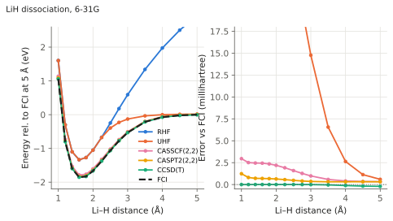
<strong>CASSCF and CASPT2 vs FCI</strong>
<span>LiH dissociation with RHF, UHF, CASSCF, CASPT2, CCSD(T), and exact FCI.</span>
</a>

<a class="oqp-card" href="formaldehyde-qmmm/" markdown>
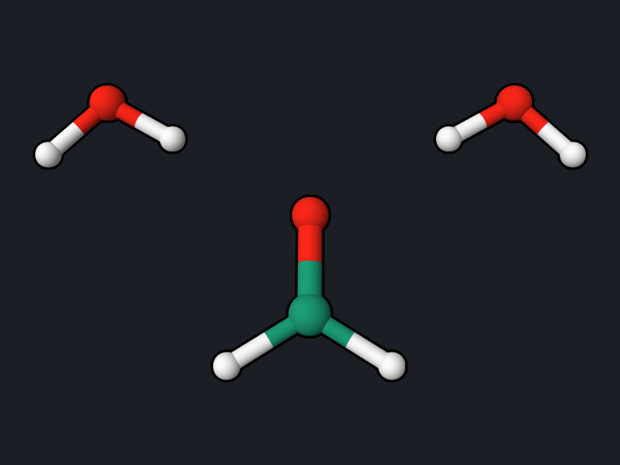
<strong>QM/MM solvent shift</strong>
<span>n→π* shift of formaldehyde from two water molecules, QM/MM vs full QM.</span>
</a>

<a class="oqp-card" href="auh-relativity/" markdown>
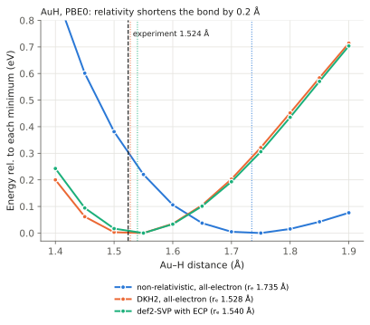
<strong>Relativity in gold hydride</strong>
<span>Non-relativistic vs DKH2 vs relativistic ECP: the Au–H bond shrinks by 0.2 Å.</span>
</a>

<a class="oqp-card" href="hi-ecp/" markdown>
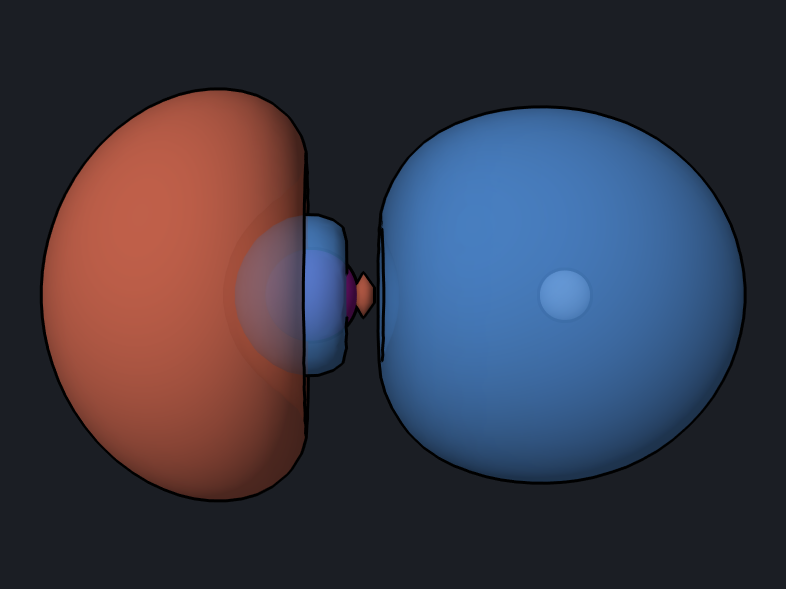
<strong>Effective core potentials</strong>
<span>HI with the def2-SVP ECP: optimization, frequency, dipole, valence orbitals.</span>
</a>

<a class="oqp-card" href="ethylene-mecp/" markdown>
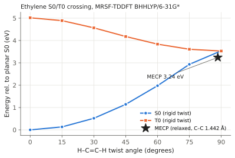
<strong>Singlet–triplet crossing (MECP)</strong>
<span>S0/T0 minimum-energy crossing point of ethylene and the spin-orbit coupling there.</span>
</a>

<a class="oqp-card" href="formaldehyde-qmmm-namd/" markdown>
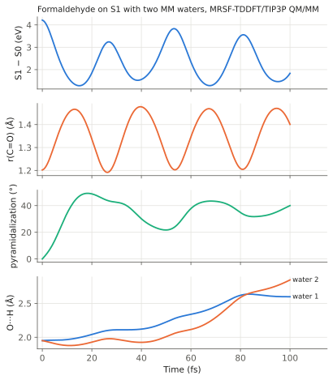
<strong>QM/MM excited-state dynamics</strong>
<span>Formaldehyde on S1 with two MM waters: pyramidalization and H-bond breaking.</span>
</a>

<a class="oqp-card" href="nh3-neb/" markdown>

<strong>Reaction path by NEB</strong>
<span>Ammonia umbrella inversion with a 9-image nudged elastic band, checked against the planar transition state.</span>
</a>

<a class="oqp-card" href="formaldehyde-s1-opt/" markdown>
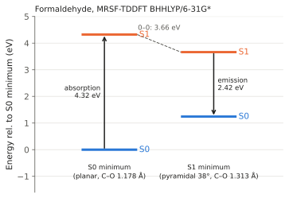
<strong>Excited-state optimization</strong>
<span>S0 and S1 minima of formaldehyde: absorption, emission, and the 0–0 energy.</span>
</a>

<a class="oqp-card" href="python-state-analysis/" markdown>
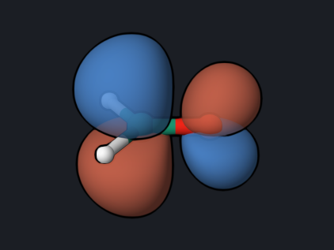
<strong>Python API and state analysis</strong>
<span>A Python script: MRSF run, natural transition orbitals, attachment/detachment cubes.</span>
</a>

<a class="oqp-card" href="formaldehyde-xas/" markdown>
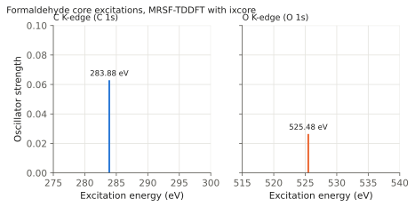
<strong>X-ray absorption</strong>
<span>Carbon and oxygen K-edges of formaldehyde with MRSF-TDDFT ixcore.</span>
</a>

<a class="oqp-card" href="formaldehyde-umrsf/" markdown>

<strong>UMRSF-TDDFT</strong>
<span>MRSF-TDDFT with an unrestricted (UHF) triplet reference, compared with ROHF.</span>
</a>

<a class="oqp-card" href="ethylene-nacme/" markdown>
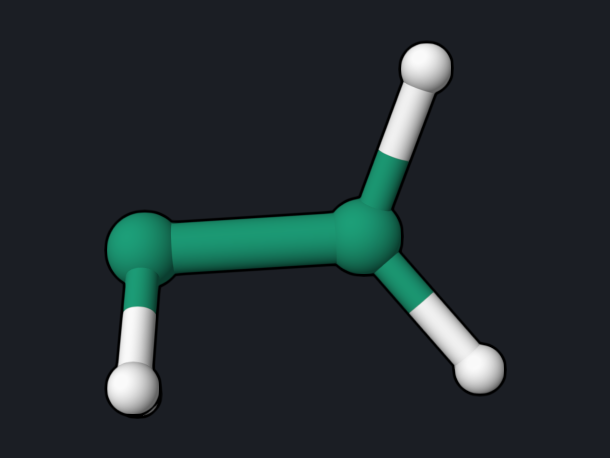
<strong>Coupling between geometries (NACME)</strong>
<span>State overlaps and derivative coupling between two frames near the S1→S0 hop.</span>
</a>

<a class="oqp-card" href="ethylene-casscf/" markdown>

<strong>CASSCF and XMCQDPT2</strong>
<span>CASSCF(2,2) optimizations, the rotation barrier, and XMCQDPT2 states of ethylene.</span>
</a>

<a class="oqp-card" href="alanine-qmmm/" markdown>

<strong>QM/MM across a covalent bond</strong>
<span>Link-atom QM/MM optimization and dynamics of the alanine dipeptide.</span>
</a>

<a class="oqp-card" href="benzene-symmetry/" markdown>
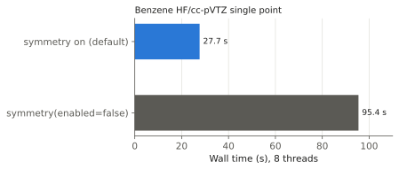
<strong>Molecular symmetry</strong>
<span>Point-group detection, orbital labels, and a 3.4× faster SCF for benzene.</span>
</a>

</div>

## How the reference values were produced

All reference values on these pages come from running exactly the inputs shown,
with OpenQP 1.3.1 (GitHub `main`, commit `f5361a2`, 20 October 2026) on macOS
x86_64 with 2 to 8 OpenMP threads. The one exception is the
[SOC-NAMD example](formaldehyde-soc-namd.md): it needs the fix in
[openqp#535](https://github.com/Open-Quantum-Platform/openqp/pull/535) and was
run with GitHub `main` commit `958495f` plus that fix (commit `20272ac5b`).
The [NEB example](nh3-neb.md) was rerun with commit `958495f` plus the
frequency-projection fix in
[openqp#538](https://github.com/Open-Quantum-Platform/openqp/pull/538)
(commit `be1c9d2`); no value on that page depends on that fix.
Molecule and orbital pictures are snapshots
of the [OQP Studio](../studio/index.md) 3D viewer, made from the output files of
the same runs.

On another computer, SCF energies normally agree with the reference values to
about 10⁻⁶ hartree. Small differences in the last digits come from DFT
integration grids, thread counts, and convergence thresholds. They are not
errors.

Where an independent code was available, the reference values were also checked
against PySCF 2.13 at the same geometry and basis set. Each page states which
values were checked.

## Reading an OpenQP run

Every run writes these files beside the input:

| File | Contents |
| --- | --- |
| `<name>.log` | The full text output, including SCF iterations, orbital energies, and all requested properties. Each page quotes the relevant part. |
| `<name>_scf_*.molden` | Molecular orbitals in Molden format. Open it in OQP Studio Analysis, [OpenqpView](https://open-quantum-platform.github.io/OpenqpView/), Molden, or Avogadro to display orbitals. |
| `<name>.hess.json`, `<name>.freq.molden` | Written by Hessian runs: frequencies, normal modes, and thermochemistry data. Open the `.freq.molden` file to animate the vibrations. |
| `opt.xyz`, `opt_status.txt` | Written by geometry optimizations and transition-state searches: the final geometry and a table of the optimization steps. |

The end of every log has an `ENERGIES AND STATES` block, which is the quickest
place to read the final energies:

```text
   PyOQP LOG | ENERGIES AND STATES
   PyOQP: Final Energy
   ========================================================================
   PyOQP Energy unit:                 Hartree
   PyOQP electronic energies
   PyOQP state 0                            -76.3256993935
```

For the full input syntax, see [`.oqp` Input](../oqp-input.md). For larger
template decks, see the [repository examples](../examples/index.md).
