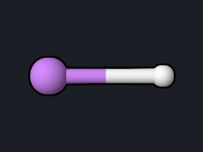

# LiH Dissociation: CASSCF, CASPT2, and FCI

CASPT2 adds second-order perturbation theory on top of a CASSCF reference:
CASSCF handles the near-degeneracy of a breaking bond, and CASPT2 adds the
remaining dynamic correlation. LiH is small enough for full configuration
interaction (FCI), the exact answer in a given basis set, so every method on
this page can be checked against it.

<div class="oqp-figs" markdown>
<figure markdown>

<figcaption>LiH at 1.6 Å</figcaption>
</figure>
</div>


## Copy and run

```text title="lih-caspt2.oqp"
caspt2/6-31g cas(active_electrons=2,active_orbitals=2,frozen_core=1,max_det=200000)
geom="""
Li 0.000000 0.000000 0.000000
H 0.000000 0.000000 1.600000
"""
```

[Download lih-caspt2.oqp](inputs/lih-caspt2.oqp)

```bash
openqp lih-caspt2.oqp
```

- `caspt2/6-31g`: single-state CASPT2 on a CASSCF reference.
- `cas(active_electrons=2,active_orbitals=2,frozen_core=1,...)`: two electrons
  in the σ bonding and σ\* antibonding orbitals; the Li 1s pair is frozen in
  the perturbation step.
- `max_det=200000`: OpenQP's CASPT2 is uncontracted, so its first-order space
  is a set of determinants. `max_det` caps its size; the default of 5000 is
  also enough for this system (the run gives the same energy without it), and
  OpenQP stops with a message naming the required size when a system needs
  more. Uncontracted CASPT2 is meant for small molecules and active
  spaces; for ethylene in 6-31G\* the space would already hold about 4 × 10¹²
  determinants.

The same geometry with the other methods (each run takes 1–2 seconds):

| Method | First line | Download |
| --- | --- | --- |
| RHF | `rhf/6-31g` | [lih-rhf.oqp](inputs/lih-rhf.oqp) |
| UHF | `uhf/6-31g scf(stability=true)` | [lih-uhf.oqp](inputs/lih-uhf.oqp) |
| CASSCF(2,2) | `casscf/6-31g cas(active_electrons=2,active_orbitals=2,frozen_core=1)` | [lih-casscf.oqp](inputs/lih-casscf.oqp) |
| CASPT2(2,2) | as above | [lih-caspt2.oqp](inputs/lih-caspt2.oqp) |
| CCSD(T) | `ccsd_t/6-31g` | [lih-ccsdt.oqp](inputs/lih-ccsdt.oqp) |
| FCI | `fci/6-31g fci(max_det=200000)` | [lih-fci.oqp](inputs/lih-fci.oqp) |

For the curve, change the H coordinate (the Li–H distance, in Å) from 1.0 to
5.0 Å.

## What you get

The CASPT2 block of the log shows the reference, the size of the first-order
space, and the second-order energy:

```text
   PyOQP active space:                 CAS(2,2)
   PyOQP PT2 frozen-core orbitals:     1
   PyOQP external (first-order) space:  96
   PyOQP E(0) reference  (CASSCF):          -7.9959166652
   PyOQP E(2) correlation:                  -0.0017465707
   PyOQP E(CASPT2  ) total:             -7.9976632359
```

The FCI run reports `PyOQP determinant count: 3025`: all 4 electrons in all
11 orbitals of 6-31G.

| Method | 1.6 Å (hartree) | 5.0 Å (hartree) | Error vs FCI at 1.6 Å |
| --- | --- | --- | --- |
| RHF | −7.97932 | −7.82238 | +19.0 mEh |
| UHF | −7.97932 | −7.92966 | +19.0 mEh |
| CASSCF(2,2) | −7.99592 | −7.92992 | +2.4 mEh |
| CASPT2(2,2) | −7.99766 | −7.92993 | +0.7 mEh |
| CCSD(T) | −7.99836 | −7.93046 | 0.0 mEh |
| FCI | −7.99836 | −7.93025 | — |

## Reading the result

- **RHF** dissociates to the wrong limit (ionic Li⁺H⁻ character), as for
  [H₂](h2-dissociation.md). **UHF** with `scf(stability=true)` breaks spin
  symmetry beyond about 2.25 Å and then reaches the right limit, but is 19 mEh
  too high near equilibrium.
- **CASSCF(2,2)** has the right shape everywhere: the error is 2.4 mEh at
  1.6 Å and falls to 0.3 mEh at 5 Å.
- **CASPT2(2,2)** reduces the error at equilibrium to 0.7 mEh. Part of what
  remains is the correlation of the frozen Li 1s pair, which FCI includes.
- **CCSD(T)** is essentially exact near equilibrium for this four-electron
  system. At 5 Å it is 0.2 mEh *below* FCI: CCSD(T) is not variational, and
  its perturbative triples become less reliable as the bond breaks.
- The FCI dissociation energy in this basis is 0.06811 hartree (1.85 eV), from
  the energies at 1.6 and 5.0 Å.

## Try next

- Replace `caspt2` with `xms-caspt2` and add
  `ci(nroot=2,target_spin=singlet) pt2(target_roots="0,1",nroot=2)` to treat
  the first excited singlet as well. At 1.6 Å this gives −7.99231 and
  −7.87520 hartree for the two states, an excitation energy of 3.19 eV.
- Replace `caspt2` with `mrmp2`: for this single-state CAS(2,2) case it gives
  the same energy as CASPT2, −7.9976632 hartree.

See also: [CASPT2 Nuclear Gradient](../workflows/caspt2-gradient.md),
[Wavefunction methods](../keywords/wavefunction.md),
[H₂ dissociation](h2-dissociation.md).
