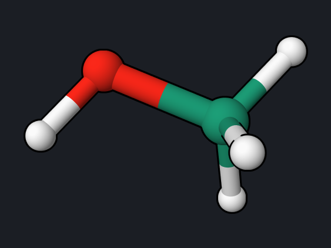

# Methanol: Ground-State Molecular Dynamics

Born–Oppenheimer molecular dynamics moves the nuclei with Newton's equations
using DFT forces computed at every step. This example runs 200 fs of methanol
dynamics and shows how to check that the run conserves energy, which is the
first test of any MD setup.

<div class="oqp-figs" markdown>
<figure markdown>

<figcaption>Methanol, starting structure</figcaption>
</figure>
</div>

## Copy and run

```text title="methanol-md.oqp"
dft/pbe0/6-31g* md(nstep=400,dt=0.5,temperature=300,seed=11)
geom="""
C     -0.368510    -0.018320    -0.040858
O      0.960471    -0.504863    -0.078151
H     -0.621773     0.274423     0.981043
H     -0.462281     0.839754    -0.710960
H     -1.046098    -0.809945    -0.369227
H      1.538190     0.218952     0.218153
"""
```

[Download methanol-md.oqp](inputs/methanol-md.oqp)

```bash
openqp methanol-md.oqp
```

`md(nstep=400,dt=0.5,...)` runs 400 steps of 0.5 fs. The initial velocities are
drawn from a Maxwell–Boltzmann distribution at 300 K; `seed=11` fixes the
random numbers so that the run can be repeated exactly. The starting structure
is a force-field structure, not a PBE0 minimum, which is fine for MD. The run
takes about 4.5 minutes with 4 threads (0.65 s per step).

## What you get

| File | Contents |
| --- | --- |
| `methanol-md.md.csv` | one row per step: time, potential, kinetic, and total energy (hartree), temperature (K) |
| `methanol-md.md.xyz` | the trajectory, one frame per step, with time and energy in the comment line; open it in OQP Studio, VMD, or Avogadro to watch the motion |
| `methanol-md.log` | the full log |

The first and last rows of the CSV file:

```text
step,time_fs,potential_hartree,kinetic_hartree,total_hartree,temperature_kelvin,thermostat_exchange_hartree,thermostat_exchange_cumulative_hartree
0,0.0000000000,-115.5781380818157,0.006253338174754533,-115.5718847436409,263.2864023367,0,0
...
400,200.0000000000,-115.5771554056878,0.005275975351826693,-115.571879430336,222.1361663771,0,0
```


| Quantity | Reference value |
| --- | --- |
| Initial temperature | 263 K |
| Mean temperature over 200 fs | 191 K |
| Range of the total energy | 3.7 × 10⁻⁵ hartree (0.023 kcal/mol) |

## Reading the result

- **The total energy is conserved.** Potential and kinetic energy exchange
  continuously while their sum stays within 0.023 kcal/mol. No thermostat acts
  in this run (the thermostat-exchange columns are zero), so the total energy is
  the quantity to check. A drift several orders of magnitude larger would point
  to a time step that is too long or an SCF that is not converged tightly
  enough.
- **The temperature is not 300 K.** For six atoms, one random draw at 300 K
  gave 263 K. Because the run starts close to a potential minimum, part of the
  kinetic energy flows into potential energy, and the average settles near
  190 K. Equilibrate with a thermostat before collecting statistics.
- The fast oscillations are the O–H and C–H stretching vibrations, with periods
  of about 10 fs.

## Try next

- Double the time step to `dt=1.0` and compare the total-energy range.
- Run longer with `nstep=2000` and look at the methyl rotation in the
  trajectory file.

See also: [md keywords](../keywords/md.md),
[Initial conditions and restart](../keywords/md-initial-restart.md).
