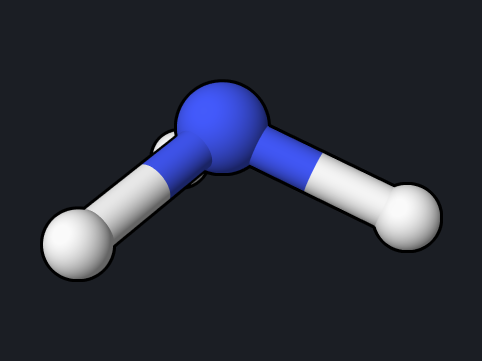
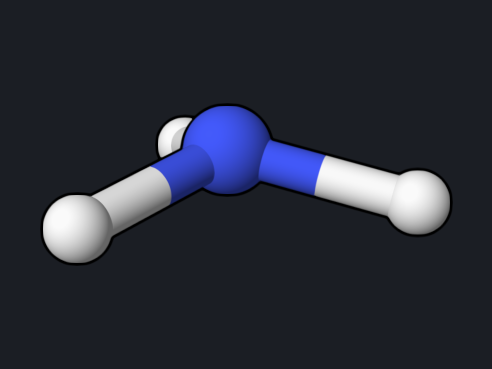
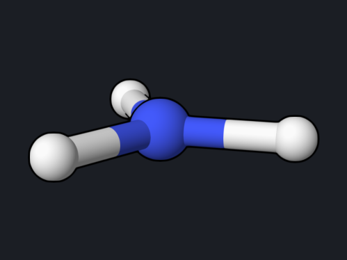
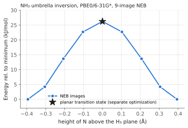

# Ammonia Inversion: Nudged Elastic Band (NEB)

The nudged elastic band (NEB) method finds a reaction path between two known
structures without a transition-state guess: a chain of intermediate structures
(images) connected by springs is relaxed until it lies along the minimum-energy
path. Ammonia turns inside out like an umbrella through a planar transition
state; the barrier is small and well known, which makes it a clean NEB test.

<div class="oqp-figs" markdown>
<figure markdown>

<figcaption>Image 1: pyramidal NH₃ (reactant)</figcaption>
</figure>
<figure markdown>

<figcaption>Image 3: halfway to planar</figcaption>
</figure>
<figure markdown>

<figcaption>Image 5: planar, the top of the path</figcaption>
</figure>
</div>



## Copy and run

The NEB needs the reactant in the input and the product as a separate XYZ
file. Download both into one folder:
[nh3-neb.oqp](inputs/nh3-neb.oqp) and
[nh3-inverted.xyz](inputs/nh3-inverted.xyz).

```text title="nh3-neb.oqp"
dft/pbe0/6-31g* neb(S0,product="nh3-inverted.xyz",images=9) dftgrid(rad_npts=150,ang_npts=974)
geom="""
N      0.000000     0.000000     0.098477
H      0.000000     0.937185    -0.295432
H     -0.811626    -0.468592    -0.295432
H      0.811626    -0.468592    -0.295432
"""
```

```text title="nh3-inverted.xyz"
4
NH3 with the umbrella inverted (mirror image through the xy plane)
N      0.000000     0.000000    -0.098477
H      0.000000     0.937185     0.295432
H     -0.811626    -0.468592     0.295432
H      0.811626    -0.468592     0.295432
```

```bash
openqp nh3-neb.oqp
```

- The reactant is the PBE0/6-31G* minimum (from
  [nh3-opt.oqp](inputs/nh3-opt.oqp), r(N–H) = 1.017 Å, ∠HNH = 105.9°); the
  product is its mirror image.
- `neb(S0,product=...,images=9)` relaxes a band of nine images, including the
  two fixed end points, on the ground-state surface. Both end points should be
  minima of the same method, basis set and integration grid.
- `dftgrid(rad_npts=150,ang_npts=974)` replaces the default SG2 grid with a
  denser 150 × 974-point grid; every input on this page uses it. The default
  grid is not symmetric under the three-fold rotation of NH₃, so it moves the
  energy by about 1e-5 hartree when the molecule is rotated and splits the
  degenerate vibrational frequencies by up to 2 cm⁻¹. The denser grid removes
  both effects, at about ten times the cost.

The run takes about 7 minutes on 4 threads (under a minute with the default
grid) and converges in 22 band iterations:

```text
   PyOQP: NEB Has Converged (fmax=1.604e-03, frms=5.392e-04 in 22 iters)
   PyOQP: Native NEB path written to .../nh3-neb_neb.xyz
```

## What you get

`nh3-neb_neb.xyz` contains all nine images as one multi-frame XYZ file, with
the energy of each image in its comment line; open it in OQP Studio, VMD, or
Avogadro to play the path. The energies:

| Image | 1 | 2 | 3 | 4 | **5** | 6 | 7 | 8 | 9 |
| --- | --- | --- | --- | --- | --- | --- | --- | --- | --- |
| E − E(min), kJ/mol | 0.00 | 4.21 | 13.70 | 22.76 | **26.32** | 22.76 | 13.70 | 4.21 | 0.00 |

## Check the top of the band

The highest image is close to, but not exactly at, the transition state. To
confirm it, optimize the planar structure directly
([nh3-planar-opt.oqp](inputs/nh3-planar-opt.oqp)): started from an exactly
planar geometry, the D3h symmetry keeps it planar and the optimization lands on
the saddle point, r(N–H) = 0.999 Å. A Hessian there
([nh3-planar-ts.oqp](inputs/nh3-planar-ts.oqp)) has exactly one imaginary
frequency, the umbrella motion, and the degenerate pair of bending modes
(modes 2 and 3) agrees to 0.01 cm⁻¹:

```text
   Mode  Symmetry     Frequency(cm-1)      IR(km/mol)      Raman(bohr^4/amu)
      1        b1           -890.85       591.962256             0.000000
      2        b2           1608.52        44.254929            28.998035
      3        a1           1608.53        44.253845            29.000777
```

This table is from GitHub `main` commit `0b75a06`, which includes the IR unit
fix [openqp#533](https://github.com/Open-Quantum-Platform/openqp/pull/533);
older builds print the same frequencies with IR intensities 23 times smaller.

| Quantity | Reference value |
| --- | --- |
| Highest NEB image | 26.32 kJ/mol |
| Optimized planar transition state | 26.30 kJ/mol (−56.4672609 hartree) |
| Pyramidal minimum | −56.4772790 hartree |
| Experiment (inversion barrier) | about 24 kJ/mol |

## The same transition state by QST2

When both end points are known, a QST2 (quadratic synchronous transit) search
locates the transition state directly, without a band of images:

```text title="nh3-qst2.oqp"
dft/pbe0/6-31g* ts(S0,search="qst2",product="nh3-inverted.xyz") dftgrid(rad_npts=150,ang_npts=974)
geom="""
N      0.000000     0.000000     0.098477
H      0.000000     0.937185    -0.295432
H     -0.811626    -0.468592    -0.295432
H      0.811626    -0.468592    -0.295432
"""
```

[Download nh3-qst2.oqp](inputs/nh3-qst2.oqp) (uses the same
`nh3-inverted.xyz`)

`ts(S0,search="qst2",product=...)` builds a guess between the two end points
and refines it as a transition-state search. It converges in 7 steps, in about
20 seconds, to −56.4672609 hartree, the same planar structure as the direct D3h
optimization above (r(N–H) = 0.999 Å). With a third structure close to the
transition state, `search="qst3"` with `guess="..."` uses it as an additional
hint.

| Method | Barrier | Runtime |
| --- | --- | --- |
| NEB, highest of 9 images | 26.32 kJ/mol | 7 min |
| QST2 transition-state search | 26.30 kJ/mol | 20 s |
| D3h optimization of the planar structure | 26.30 kJ/mol | — |

NEB gives the whole path; QST2 gives only the transition state, but faster.

## Reading the result

- **The band finds the path without a guess.** Starting only from the two
  end points, NEB places its highest image within 0.02 kJ/mol of the
  separately optimized transition state.
- **The path is symmetric**, as it must be for a reaction between mirror
  images, and the barrier is close to experiment.
- **Choose end points that define a meaningful path.** NEB starts from an
  interpolation between the end points. For a reaction such as HCN → HNC,
  where both end points are linear, the straight-line interpolation moves the
  hydrogen through the C≡N bond; use a transition-state search with a bent
  guess instead (see the [HCN example](hcn-isomerization.md)).

## Try next

- Use more images, `images=15`, and compare the highest energy.
- Use the highest image as the starting structure of a `ts(S0)` search for a
  transition state that is not fixed by symmetry.

See also: [Transition-State Searches](../workflows/transition-state-search.md),
[`neb`](../keywords/neb.md).
