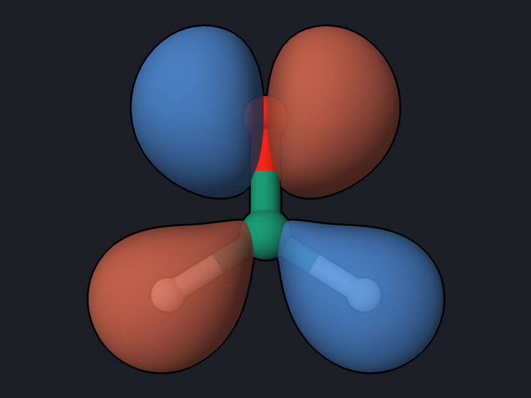
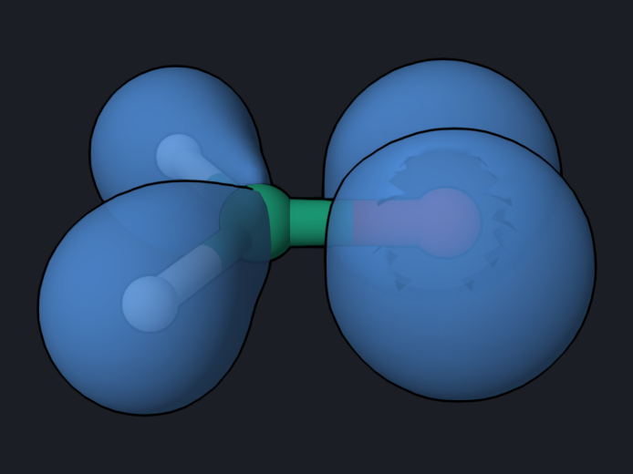
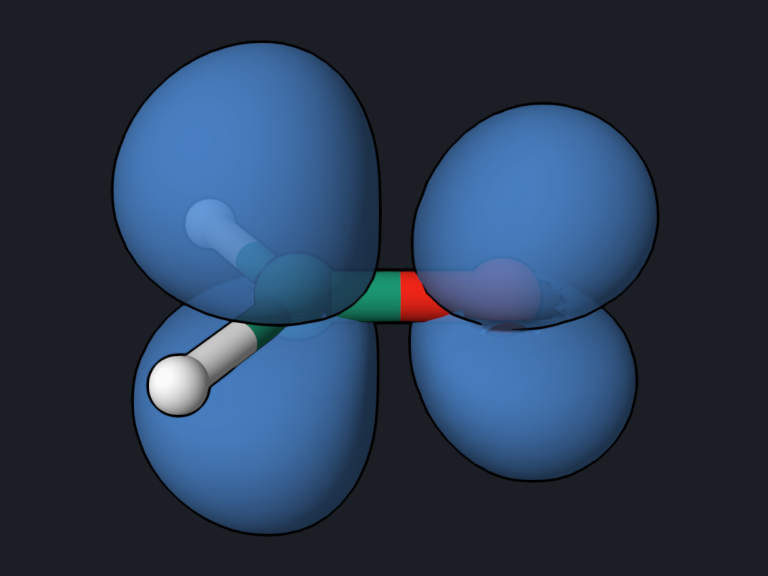

# Running OpenQP from Python: Excited-State Analysis

Everything on the other pages can also be driven from Python. Python is the
natural choice when the calculation is only the first step: here a script runs
MRSF-TDDFT on formaldehyde and then analyses the excited states with natural
transition orbitals (NTOs) and attachment/detachment densities, writing cube
files for each.

<div class="oqp-figs" markdown>
<figure markdown>

<figcaption>S0→S1 hole NTO: the oxygen lone pair n</figcaption>
</figure>
<figure markdown>

<figcaption>S0→S1 particle NTO: the C=O π*</figcaption>
</figure>
<figure markdown>

<figcaption>Detachment density (0.004 a.u.): where the electron leaves</figcaption>
</figure>
<figure markdown>

<figcaption>Attachment density (0.004 a.u.): where it arrives</figcaption>
</figure>
</div>

## The script

[Download formaldehyde_analysis.py](inputs/formaldehyde_analysis.py)

```python
"""MRSF-TDDFT of formaldehyde from Python, with NTO and attachment/detachment analysis."""
from oqp.openqp import OpenQP
from oqp.interop import MRSFExcitedStates, nto_transition, attachment_detachment
from oqp.export.cubegen import CubeExporter

job = OpenQP("formaldehyde_mrsf", silent=1)
job.molecule(
    """
C      0.000000     0.000000    -0.526342
O      0.000000     0.000000     0.676110
H      0.000000     0.937620    -1.119884
H      0.000000    -0.937620    -1.119884
""",
    charge=0,
)
job.theory.mrsf(functional="bhhlyp", basis="6-31g*", nstate=4)
mol = job.run()

results = mol.get_results()
ref = results["energy"]                # internal high-spin triplet reference
for n, de in enumerate(results["td_energies"]):   # state energies relative to it
    print(f"S{n}: {ref + de:.7f} hartree")

states = MRSFExcitedStates(mol)
cubes = CubeExporter(states)
for n in (1, 2):
    nto = nto_transition(states, 0, n)
    ad = attachment_detachment(states, n)
    print(f"S0 -> S{n}: oscillator strength {states.oscillator_strength(0, n):.4f}, "
          f"leading NTO weight {nto['weights'][0] / nto['weights'].sum():.3f}, "
          f"promoted electrons {ad['n_promoted']:.3f}")
    cubes.nto_cube(f"S{n}_hole.cube", nto["holes_ao"][:, 0], f"S{n} hole")
    cubes.nto_cube(f"S{n}_particle.cube", nto["particles_ao"][:, 0], f"S{n} particle")
    cubes.attachment_detachment_cubes(f"S{n}_attach.cube", f"S{n}_detach.cube", ad)
```

Run it with the Python environment in which OpenQP is installed:

```bash
python formaldehyde_analysis.py
```

- `OpenQP(...)`, `job.molecule(...)`, and `job.theory.mrsf(...)` set up the same
  calculation as the `.oqp` route `mrsf(nstate=4)/bhhlyp/6-31g*`; `job.run()`
  runs it and returns the molecule object with all results.
- `results["energy"]` is the energy of the internal high-spin triplet
  reference, and `results["td_energies"]` are the state energies relative to
  it; their sum is the absolute energy of each state.
- `MRSFExcitedStates(mol)` gives access to transition and difference densities.
  `nto_transition(states, 0, n)` computes the NTOs of the S0→Sn transition,
  `attachment_detachment(states, n)` the attachment and detachment densities.
- `CubeExporter(states)` writes Gaussian cube files on a regular grid for
  viewing in OQP Studio, VMD, or other programs.

The script takes about 20 seconds.

## What you get

```text
S0: -114.4212164 hartree
S1: -114.2710381 hartree
S2: -114.1004661 hartree
S3: -114.0941225 hartree
S0 -> S1: oscillator strength 0.0000, leading NTO weight 1.000, promoted electrons 1.043
S0 -> S2: oscillator strength 0.0052, leading NTO weight 1.000, promoted electrons 1.104
```

and eight cube files, `S1_hole.cube` to `S2_detach.cube`. The S1 energy agrees
with the [`.oqp` runs](formaldehyde-soc.md) at this geometry (4.087 eV above S0).

## Reading the result

- **One NTO pair describes S1 completely.** The leading NTO weight is 1.000:
  S0→S1 is a single, clean excitation from the oxygen lone pair n into the C=O
  π\* orbital, as the pictures show.
- **About one electron is promoted.** The promotion number 1.04 counts how many
  electrons move between the detachment and attachment densities; a value near
  1 is what a single excitation gives.
- **Attachment and detachment** show the same n→π\* change as density
  differences: the electron leaves the in-plane lone-pair region on oxygen and
  arrives in the π\* lobes above and below the C=O bond.

## Try next

- Analyse S0→S2 in the same way and open `S2_hole.cube` and
  `S2_particle.cube`.
- Pass a fragment list to `analyze_mrsf_transition` (see
  [MRSF Analysis and Interoperability](../workflows/mrsf-analysis.md)) to split a
  larger molecule into donor and acceptor parts and measure charge-transfer
  character.

See also: [Run OpenQP from Python](../python-scripting.md),
[MRSF Analysis and Interoperability](../workflows/mrsf-analysis.md),
[Python API](../api/python-runner.md).
