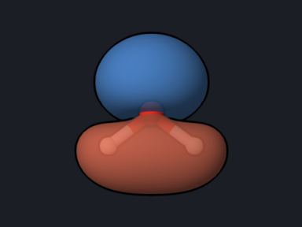
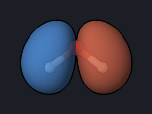

# Water: Ionization Energies and Dyson Orbitals (MRSF-EKT)

The extended Koopmans' theorem (EKT) gives ionization energies from a correlated
wavefunction, together with the Dyson orbital of each ionization: the orbital
from which the electron is removed. Dyson orbitals are what photoelectron
spectroscopy measures. OpenQP computes them from the MRSF-TDDFT ground state.

<div class="oqp-figs" markdown>
<figure markdown>

<figcaption>Dyson orbital, first ionization (1b1)</figcaption>
</figure>
<figure markdown>

<figcaption>Second ionization (3a1)</figcaption>
</figure>
<figure markdown>

<figcaption>Third ionization (1b2)</figcaption>
</figure>
</div>

## Copy and run

```text title="water-ekt.oqp"
mrsf(nstate=10)/bhhlyp/6-31g* ekt scf(save_molden=true)
geom="""
O      0.000000     0.000000     0.122745
H      0.000000     0.759541    -0.471922
H      0.000000    -0.759541    -0.471922
"""
```

[Download water-ekt.oqp](inputs/water-ekt.oqp)

```bash
openqp water-ekt.oqp
```

`ekt` computes ionization potentials (the default; `ekt(ip=false,ea=true)`
gives electron affinities instead) from the relaxed MRSF S0 density.
`scf(save_molden=true)` writes the Dyson orbitals to
`water-ekt_dyson_rohf_bhhlyp_6-31gs.molden`. The run takes about 2 seconds.

## What you get

```text
  MRSF-EKT ionization potentials (Dyson roots)
  Rows index EKT Dyson roots/orbitals, not TDDFT excited states.
  dyson      eig(ha)        eBE(ha)        eBE(eV)       metric       strength
      1      -19.692297       19.692297      535.8547      1.000000      1.000000
      2       -1.136394        1.136394       30.9228      1.000000      1.000409
      3       -0.593666        0.593666       16.1545      1.000000      1.005962
      4       -0.454481        0.454481       12.3671      1.000000      1.003072
      5       -0.378120        0.378120       10.2892      1.000000      1.002174
```

`eBE` is the electron binding energy, that is, the ionization energy, and
`strength` the pole strength of each Dyson orbital.

| Ionization | MRSF-EKT (eV) | Experiment, vertical (eV) |
| --- | --- | --- |
| 1b1 (out-of-plane lone pair) | 10.29 | 12.62 |
| 3a1 | 12.37 | 14.74 |
| 1b2 | 16.15 | 18.51 |
| 2a1 | 30.92 | — |
| 1a1 (O 1s) | 535.85 | — |

## Reading the result

- The order of the ionizations and the shape of each Dyson orbital match the
  photoelectron spectrum: the first electron is removed from the out-of-plane
  oxygen lone pair.
- With this small basis set and BHHLYP, the three outer-valence ionization
  energies are 2.3–2.4 eV below the experimental vertical values, so the
  spacing between the bands is reproduced much better than the absolute
  values. Larger, diffuse basis sets change the absolute values.
- The Dyson orbitals are in the Molden file with the labels
  `Dyson-IP-state-1` to `Dyson-IP-state-5`; open the file in OQP Studio
  Analysis or [OpenqpView](https://open-quantum-platform.github.io/OpenqpView/)
  and select them by label.

## Try next

- Compute electron affinities with `ekt(ip=false,ea=true)`.
- Compare `6-31g*` with `aug-cc-pvdz` for the first ionization energy.

See also: [MRSF-EKT](../workflows/ekt.md), [`ekt`](../keywords/ekt.md).
