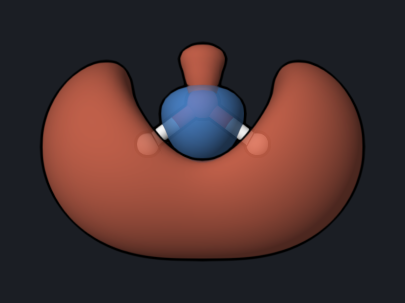

# Water: Energy, Orbitals, and Charges

A single-point DFT calculation is the simplest OpenQP run. Here it gives the
total energy of water, the energy of every molecular orbital, pictures of the
frontier orbitals, the dipole moment, and Mulliken atomic charges.

<div class="oqp-figs" markdown>
<figure markdown>

<figcaption>Water at the PBE0/6-31G* geometry</figcaption>
</figure>
<figure markdown>

<figcaption>HOMO (1b1): the oxygen lone pair perpendicular to the molecular plane</figcaption>
</figure>
<figure markdown>

<figcaption>LUMO (4a1): O–H antibonding</figcaption>
</figure>
</div>

## Copy and run

```text title="water-scf.oqp"
dft/pbe0/6-31g* properties(scf_prop="el_mom,mulliken")
geom="""
O      0.000000     0.000000     0.122745
H      0.000000     0.759541    -0.471922
H      0.000000    -0.759541    -0.471922
"""
```

[Download water-scf.oqp](inputs/water-scf.oqp)

```bash
openqp water-scf.oqp
```

The first line chooses DFT with the PBE0 functional and the 6-31G* basis set.
No task keyword means a single-point energy. `properties(scf_prop=...)`
requests the dipole moment (`el_mom`) and Mulliken charges (`mulliken`); without
it, OpenQP prints only the energy and orbitals. The coordinates are in ångström.
This run takes about 2 seconds.

## What you get

| Quantity | Reference value |
| --- | --- |
| Total energy | −76.3256994 hartree |
| SCF iterations | 8 |
| Point group detected | C2v |
| HOMO energy (1b1) | −0.30453 hartree (−8.29 eV) |
| LUMO energy (4a1) | 0.08193 hartree (2.23 eV) |
| HOMO–LUMO gap | 10.52 eV |
| Dipole moment | 2.125 debye |
| Mulliken charges | O −0.803, H +0.402 |

The SCF section of `water-scf.log` ends with the converged energy. OpenQP
prints `RHF` for any closed-shell reference, including Kohn–Sham DFT:

```text
 Final RHF energy is      -76.3256993935 after   8 iterations
```

OpenQP labels every orbital with its symmetry in the detected point group:

```text
   point group:      c2v
   alpha MOs:
       1      -19.21076550  a1
       2       -1.02527488  a1
       3       -0.53207181  b2
       4       -0.38604085  a1
       5       -0.30452890  b1
       6        0.08193402  a1
```

Orbitals 1–5 are occupied (10 electrons). Orbital 1 is the oxygen 1s core
orbital, orbitals 2–4 are the O–H bonding and in-plane lone-pair orbitals, and
orbital 5, the HOMO, is the out-of-plane oxygen lone pair. The dipole moment and
charges follow:

```text
    electric dipole (Debye):
                                                   X              Y              Z             Norm
                                         D_o    -0.00000000    -0.00000000    -2.12548100     2.12548100

       #    Name        Charge
------------------------------
       1    O        -0.803453
       2    H         0.401727
       3    H         0.401727
```

The dipole lies along the C2 axis (z), as symmetry requires. The value is
larger than the experimental gas-phase dipole of water (1.85 D), which is
typical of a small basis set without diffuse functions. Mulliken charges depend
strongly on the basis set and are useful for trends, not as absolute values.

## Look at the orbitals

The orbitals are in `water-scf_scf_rhf_pbe0_6-31gs.molden`. Open this file in
[OQP Studio](../studio/analysis.md) Analysis or in
[OpenqpView](https://open-quantum-platform.github.io/OpenqpView/) and select
orbital 5 (HOMO) or 6 (LUMO). The pictures above use an isovalue of
0.05 a.u.; red and blue mark the two signs of the orbital.

## Try next

- Change `6-31g*` to `cc-pvtz`: the dipole moment drops to 1.93 D, closer to
  experiment.
- Replace `dft/pbe0` with `hf` for a Hartree–Fock calculation; the HOMO–LUMO
  gap grows from 10.5 eV to 19.2 eV.
- Add `lowdin` to `scf_prop` for Löwdin charges, for example
  `scf_prop="el_mom,mulliken,lowdin"`.

See also: [HF and DFT](../workflows/hf-dft.md),
[`properties`](../keywords/properties.md).
